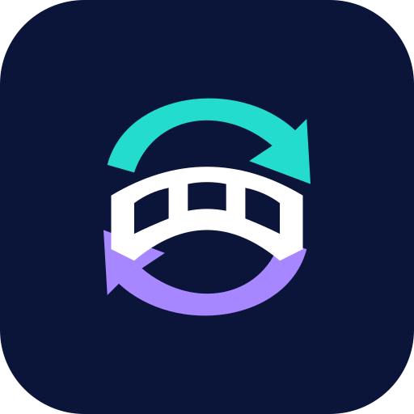

# ProtonBridge — Rareities



ProtonBridge is a personal fork of [CloudBridge](https://github.com/thies2005/CloudBridge), which
is a fork of [Round Sync](https://github.com/newhinton/Round-Sync), which comes
from [RCX](https://github.com/x0b/rcx), originally a fork of
[rcloneExplorer](https://github.com/patrykcoding/rcloneExplorer).

The main goal is to build ProtonBridge with a reviewed, pinned version of the
latest rclone beta/development code, bring in selected Proton Drive patches from
[OSS-Singularity's rclone fork](https://oss-oo.io/OSS-Singularity/rclone) used by
its Proton Drive Linux work, and implement bisync inside ProtonBridge. My
[rclone fork](https://github.com/Rareities/rclone) contains the engine changes;
this app pins an exact reviewed commit rather than following a moving branch.
I have also made other improvements and fixes to both rclone and the app.
The [full changelog and commit history](docs/FORK_CHANGELOG.md) explains what changed.

**DISCLAIMER: THIS IS HEAVILY VIBE CODED.** I know very little about Android app
development, but I know how to work with AI and have spent weeks on this project.
I think it works great for my needs, and I have taken enough steps personally to
feel comfortable using it. That is my own experience, not a guarantee that it
will work safely in every setup: **use it at your own risk**, and keep independent
backups of important files.

The reason I started this was to have a Proton Drive bisync service that could
automatically sync my folders. That use case guides the project. This is simply
a personal project; if it benefits someone else, I will be happy. Issues, pull
requests, comments and concerns are welcome. Published candidates and their
validation limits are described in the consolidated changelog.

ProtonBridge is unofficial and is not affiliated with Proton or the upstream app
authors. It has its own icon and application ID: `io.github.rareities.protonbridge`
(debug: `.debug`). It installs separately from CloudBridge/RCX. Use the app backup
and restore tools to import configuration if needed; expect fresh storage permissions
and bisync approval. Stop old schedules before enabling equivalent new tasks.

[Download ProtonBridge](https://github.com/Rareities/ProtonBridge/releases) ·
[Report an issue](https://github.com/Rareities/ProtonBridge/issues)


---

## Features

- Proton Drive folder bisync with preview, explicit initialisation approval, recovery state and scheduling.
- Browse, upload, download, move, rename and delete files across rclone-supported providers.
- Stream media and serve files over FTP, HTTP, WebDAV or DLNA.
- Crypt remotes, Storage Access Framework access, dark theme and Android 6+ support.
- Plain advanced flag editor and a searchable reference from the bundled rclone engine.

## Installation

Download a signed APK from [ProtonBridge releases](https://github.com/Rareities/ProtonBridge/releases).
Use `protonbridge_v<version>-oss-arm64-v8a-release.apk` for most phones, or
`protonbridge_v<version>-oss-universal-release.apk` if unsure. ARM32, x86 and
x86_64 builds are also available. Debug APKs have a separate `.debug` package.
ProtonBridge is distributed through this repository; upstream Play Store apps
are separate projects.

## Bisync setup

Create a remote and a Bisync task, select your folders, then follow
**Save and preview → Review and initialise → Run**. Review the initial winning
side and deletion limits, and keep independent backups. Start with disposable
folders. Changed flags require a fresh preview/review.

Enter one flag per line, for example:

```text
--conflict-resolve newer
--bwlimit 8M
```

`--flag=value` also works. Values are passed directly to rclone without shell
interpretation. The reference explains the bundled engine's flags; credentials
and app-managed safety options remain controlled by the remote/task editor.
See [usage, security, battery guidance and full change history](docs/FORK_CHANGELOG.md).

## External task requests

Package: `io.github.rareities.protonbridge`.
Activity: `io.github.rareities.protonbridge.Activities.ShortcutServiceActivity`.
Action: `START_TASK`; long extra: `task` (task ID).
An ID alone does not authorise execution: requests without a valid app-issued
shortcut capability require visible confirmation. Old shortcuts may need recreation.

## Building and contributing

Use JDK 17, Go 1.27.2, Android SDK 36 and NDK 29.0.14206865, as pinned in
`gradle.properties`. Set `sdk.dir` in `local.properties` or `ANDROID_HOME`.

```sh
git clone https://github.com/Rareities/ProtonBridge.git
cd ProtonBridge
./gradlew assembleOssDebug
./gradlew testOssDebugUnitTest lint -x :rclone:buildAll
```

The first build fetches the exact pinned rclone commit and cross-compiles all
ABIs. See [Contributing](CONTRIBUTING.md) and [Security](SECURITY.md).
Report bugs and propose changes through this fork's GitHub issues and pull requests.

## Attribution and license

ProtonBridge descends from CloudBridge by thies2005, Round Sync by Felix Nüsse,
RCX by x0b and rcloneExplorer by Patryk Kaczmarkiewicz. Attribution, contributor
credits and historical commit links are retained. Selected Proton Drive engine
patches originate from OSS Singularity. This project uses rclone, AndroidX,
Material Components, Kotlin, Glide and the other credited dependencies; see
[contributors](app/src/main/assets/contributors.md) and the dependency declarations.
Support rclone at <https://rclone.org/donate/>.

Released under [GPLv3](LICENSE). Contributions are licensed under GPLv3.
