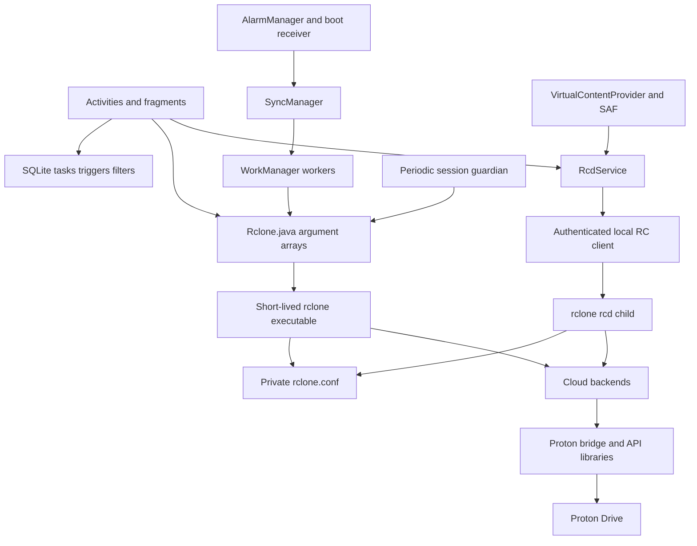
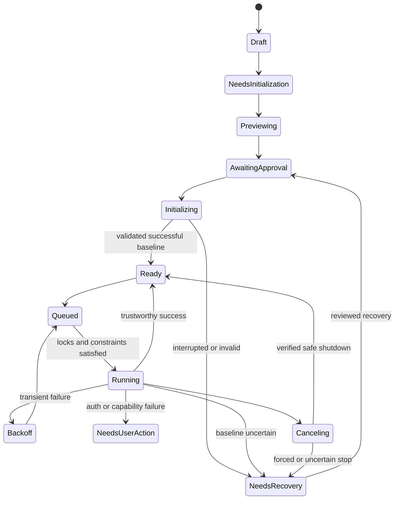

# CloudBridge & Rclone — Proton Drive Compatibility, Bisync Integration, Security, Efficiency, and Modernization Master Plan

**Research date:** 9 October 2026, UTC  
**Repositories:** Rareities/CloudBridge and Rareities/rclone  
**Status:** Research, audit, architecture design, and implementation planning only

This plan incorporates the original and reattached master prompt. Your follow-up settles the integration approach: **CloudBridge should build your rclone fork, pinned to a reviewed commit containing the approved changes.** That connection is straightforward and receives only a small work package below.

**No application code or repository configuration was changed. No dependencies, builds, tests, synchronization jobs, or authenticated Proton operations were run.** Both attached repositories remained clean. This document distinguishes source-confirmed defects, existing fixes, upstream proposals, reported problems, and capabilities requiring live validation.

---

## 1. Executive Summary

**Recommendation: preserve CloudBridge and perform targeted fixes followed by a staged refactor of job execution, configuration security, scheduling, and bisync orchestration. A complete rewrite is not justified by the inspected code.**

CloudBridge already provides useful Android file-management functionality, dynamic rclone backend configuration, cloud-to-cloud operations, structured subprocess arguments, a local authenticated RC service, SQLite persistence, and Storage Access Framework integration. These are valuable foundations.

The major findings are:

| Finding | Evidence strength | Consequence |
|---|---|---|
| CloudBridge currently builds an older thies2005/rclone commit rather than Rareities/rclone | Confirmed configuration | Your current engine fixes do not automatically reach CloudBridge |
| Sync workers discard rclone’s process exit code | Confirmed code defect | Failed operations can produce success notifications and success follow-ups |
| Importer deletes existing jobs before parsing replacement data | Confirmed code defect | Malformed imports can erase configuration |
| ZIP restore replaces components before validating the complete package | Confirmed code defect | Restore can leave mixed configuration |
| Proton callbacks use package-global credential state | Confirmed code defect | Multiple filesystem instances can update the wrong remote’s credentials |
| Cached Proton initialization clears credentials on every error | Confirmed broad error handling | Transient failures can trigger unnecessary reauthentication |
| Bisync constants exist, but execution and editing do not provide a complete supported feature | Confirmed incomplete implementation | Enabling the existing constants would not create safe bisync |
| Legacy bisync directions can map to one-way sync during editing | Confirmed conversion path; runtime reproduction unperformed | Existing imported tasks require protective migration |
| Diagnostics can log proxy credentials and request HTTP header dumps | Confirmed code paths | Diagnostic output can expose secrets |
| Encrypted configuration import is rewritten as plaintext | Confirmed code behavior | Encryption is not maintained at rest |
| Exported shortcut activity accepts task IDs without scoped authorization | Confirmed code path | Another local application can request execution of configured tasks |
| Daily scheduling contains minute-only comparison and fixed-day arithmetic | Confirmed code defects | Incorrect next runs and DST behavior |
| Current rclone fork includes important Proton, bisync, and security fixes | Confirmed source history | Preserve and validate these rather than duplicating them |
| Forgejo Proton backend matches your current backend file | Confirmed textual comparison | No unique patch was found in that file |
| Official Proton SDK anticipates a crypto migration and remains unsuitable for production third-party integration | Official documentation | Compatibility needs an explicit maintenance and release gate |

Three upstream proposals deserve particular attention:

1. **rclone PR #9881**, together with go-proton-api PR #10 and Proton-API-Bridge PR #9, proposes session-bound callbacks and adoption of credentials rotated by another filesystem instance.
2. **rclone PR #9851** proposes decrypted-name fallback for modern Proton filename hashes.
3. **Proton-API-Bridge PR #6 must be rejected as submitted.** Its description says invalid signatures still fail, but the inspected patch discards signature-verification errors.

The recommended architecture remains an Android orchestration layer around rclone:

- Short-lived CLI children for synchronization jobs.
- Authenticated local RC for document-provider and browsing operations.
- Durable, private bisync state.
- One authoritative job lifecycle and terminal result.
- WorkManager and AlarmManager scheduling through a shared calculation layer.
- Conservative account and path concurrency.
- Typed, version-aware advanced options.
- Explicit initialization and recovery.
- Measured resource budgets.

The original prompt mentions laptop battery and sleep behavior. **These repositories currently implement an Android application.** Android power management and foreground-work restrictions are the immediate requirements. A desktop application would be a separate, conditional product decision.

---

## 2. Product Vision and Engineering Principles

CloudBridge should make rclone’s capabilities understandable and dependable without recreating its transfer engine, backend abstraction, encryption, or reconciliation algorithm.

The product should optimize for:

1. Data integrity and authenticated cryptography.
2. Security and privacy.
3. Truthful outcomes and recoverability.
4. Backend and operating-system compatibility.
5. Useful functionality.
6. Measured battery and resource efficiency.
7. Maintainability and straightforward operation.

Every implementation must preserve these distinctions:

- **Source-confirmed:** observed directly in inspected code.
- **Upstream-reported:** described by a maintainer or user; applicability assessed separately.
- **Candidate fix:** inspected proposal not yet proven in the selected release.
- **Conditional capability:** requires fixtures, devices, accounts, or service support.
- **Measured:** reserved for actual executed measurements.

No benchmark improvement justifies suppressing checksums, signature verification, deletion protection, or trustworthy error handling.

### Priority and disposition

| Priority | Meaning |
|---|---|
| P0 | Severe data-loss risk, critical security issue, or blocking correctness |
| P1 | High-impact reliability, compatibility, or security |
| P2 | Important functionality, efficiency, or justified refactor |
| P3 | Optional enhancement |

Disposition is separate: **Required, Recommended, Conditional, Optional, or Rejected**.

A P0 safeguard for a proposed bisync feature is a release condition. It does not imply that the currently disabled feature has already caused data loss.

### Product boundaries

Preserve:

- Existing copy and one-way sync.
- Cloud-to-cloud operations.
- Dynamic backend forms.
- Android document-provider integration.
- Existing task identities and exports where safely migratable.
- Structured subprocess execution.
- rclone’s transfer and bisync engines.

Avoid:

- A second synchronization algorithm.
- Custom cryptography or SRP.
- Unrestricted shell execution.
- Permanently running background synchronization loops.
- Automatic resync after uncertainty.
- Framework replacement solely for modernization.

---

## 3. Repository Baseline

### 3.1 Verified repositories

| Source | Inspected baseline | Interpretation |
|---|---|---|
| [Rareities/CloudBridge](https://github.com/Rareities/CloudBridge) | `ece9275441e448ec520a7cbc336c59bfe643b22c` | Default branch `master`; attached checkout on `work` |
| [thies2005/CloudBridge](https://github.com/thies2005/CloudBridge) | Same SHA at retrieval | No current parent divergence at that snapshot |
| [Rareities/rclone](https://github.com/Rareities/rclone) | `3a5758eeaa7250635f756f56c84128445d33ebe2` | Default branch `master`; attached checkout on `work` |
| Rareities/rclone audit branch | `c32e64db8f3df7b5a55627823009c67f57c1c01f` | Adds an audit workflow; no distinct Proton backend implementation |
| Official rclone master | `4f19e9cd6f442282d7fa8d5fdbd28ebb68be1131` | At comparison, your fork was six commits ahead and two behind |
| Official latest stable release | v1.75.2 | Published 9 October 2026 |
| CloudBridge’s configured engine | thies2005/rclone `94f543c9d4df4f7a29c87c9b76abf7bb341b5d33` | Source VERSION v1.74.3 |
| thies2005/rclone default | `38111b3574fa2b32489ca5a10ff14d0261af7849` | Newer than app pin; contains Android/Internxt-specific work |
| [OSS-Singularity/rclone](https://oss-oo.io/OSS-Singularity/rclone) | `1583cce1e28340e5d064ed955179f5f2b31e7757` | Inspected through isolated research clone |
| [ProtonDriveApps/sdk](https://github.com/ProtonDriveApps/sdk) | `8ffae007b0fbb8bcef53514719d6f093bb32dcf9` | Official SDK documentation snapshot |

CloudBridge’s fork lineage includes thies2005/CloudBridge and the older RCX/rcloneExplorer family. Historical Round Sync discussions are relevant context, not proof that the current application needs replacement.

### 3.2 Build facts

| Component | Observed configuration |
|---|---|
| Application | Android Java/Kotlin Views |
| Application ID | `de.schuelken.cloudbridge` |
| Legacy package | `ca.pkay.rcloneexplorer` |
| Minimum Android SDK | 23 |
| Compile/target SDK | 36 |
| App version defaults | 1.0.1; versionCode 20 with ABI offsets |
| JDK | 17 |
| Kotlin | 1.9.22 |
| Android Gradle Plugin | 8.13.2 |
| Configured Go requirement | 1.25.0 |
| Current Rareities/rclone Go requirement | **1.26.0** |
| NDK | 29.0.14206865 |
| Native toolchain label | API 33 |
| Native build | `GOOS=linux`, `CGO_ENABLED=0`; executable packaged as `librclone.so` |
| Build tag | `noselfupdate` |
| ABIs | armeabi-v7a, arm64-v8a, x86, x86_64, universal |

The native filename does not mean CloudBridge embeds rclone through JNI.

The inspected Rareities source VERSION is **v1.76.0**, a development-tree label. It includes the v1.75.2 security changelog and fixes. Do not label that exact source as a stable v1.75.2 binary merely because it contains those patches.

### 3.3 Relevant engine dependencies

| Dependency | CloudBridge’s existing source pin | Rareities candidate |
|---|---|---|
| Proton-API-Bridge | 1.0.3 | 1.0.5 |
| go-proton-api | 1.0.2 | 1.0.4 |
| gopenpgp | v2, 2.9.0 | v3, 3.4.1 |
| golang.org/x/net | 0.55.0 | 0.60.0 |

### 3.4 Settled integration decision

CloudBridge should use:

```properties
de.schuelken.cloudbridge.rCloneRepoUrl=https://github.com/Rareities/rclone.git
de.schuelken.cloudbridge.rCloneRef=<final-reviewed-immutable-SHA>
```

The final SHA should contain the approved engine changes. Align Go/version metadata and preserve any required Android DNS and Internxt changes inside your fork. The existing checkout cache must verify its Git origin when the repository URL changes.

Do not use a moving branch, patch generated cache files, or introduce a second engine-selection framework.

### 3.5 Research limitations

No installed APK, private Proton account, signing key, device trace, live compatibility result, or successful CI run was verified. No performance or battery measurements were performed.

Both source checkouts were clean at the final check. Repository source inspection does not establish that every shipped artifact contains exactly the configured source.

---

## 4. Current Architecture



### Execution

`Rclone.java` uses command arrays and `Runtime.exec(String[], env)`. Synchronization jobs generally use short-lived processes. Browsing and document streaming use a persistent local RC process.

This combination is reasonable. CLI gives job isolation and clear exit status; RC supports document access without starting a child for each read.

### Persistence

SQLite stores tasks, triggers, and filters. JSON serialization supports export/import. The database is currently version 8.

Task fields include:

- Remote and local paths.
- Direction.
- Second remote/path for cloud-to-cloud operations.
- Wi-Fi preference.
- Checksum switch.
- Filtering and deletion settings.
- Success/failure follow-ups.
- Optional transfer count.

There is no complete durable bisync lifecycle or baseline identity.

### Configuration

Private `rclone.conf` contains remote credentials and cached sessions. Rclone password obscuring is reversible and does not provide encryption at rest.

Configuration is accessed by both CLI and RC children. A recent config-dump cache reduces repeated subprocesses, but configuration identity and multi-process mutation still need explicit management.

### Scheduling

`SyncManager` enqueues ordinary one-time requests with task tags. It does not establish unique execution by stable job identity.

TriggerService uses alarms for daily/interval execution. BootReceiver requeues triggers. There is no durable missed-run policy, timezone model, or comprehensive schedule calculation layer.

### Power and lifetime

TransferLocks principally releases locks in `finally`. The RC monitor blocks on a queue when there is no work. Its one-second scheduled monitor must **not** be described as idle busy polling.

RcdService has memory-pressure shutdown behavior, but no normal demand-based idle grace policy. SessionGuardian performs constrained periodic checks every eight hours.

### Security boundaries

Important boundaries are:

- Exported Android components.
- User-selected imports.
- Private configuration and exported archives.
- Subprocess arguments/environment.
- Local RC HTTP.
- Optional LAN serving.
- Authenticated cloud responses and encrypted metadata.
- Release signing and upstream automation.

---

## 5. Existing Functionality and Fix Inventory

| Existing behavior/fix | Evidence | Required treatment |
|---|---|---|
| One-way sync/copy | Existing task/worker paths | Preserve |
| Cloud-to-cloud directions 7/8 | CloudBridge commit `21e70006` | Preserve and include in migration tests |
| Structured command arrays | Rclone process wrapper | Preserve |
| Scoped cancellation | SyncManager tags | Preserve; add unique job coordination |
| Batched multi-selection deletion | Commit `ece92754`, DeleteManifest | Preserve |
| Exact-file fallback for newline names | DeleteManifest/EphemeralWorker | Preserve |
| Corrected foreground setup | EphemeralWorker history | Do not regress |
| Config-dump caching | Rclone cache implementation | Preserve and extend identity |
| Authenticated loopback RC | Generated password and localhost binding | Preserve |
| Stable RC service coordination | RcdService synchronization | Preserve |
| Active-transfer lock release | TransferLocks callers | Preserve |
| Guardian network-error suppression | SessionGuardianWorker | Preserve; improve remaining classification |
| Awaited update-check work | Coroutine UpdateWorker | Preserve |
| Notification-only updates | Update workflow | Preserve; no unattended APK installer |
| Release keystore-path correction | `8560bc15` | Preserve; remove remaining fallback separately |
| Compliant third-party app-version handling | Proton backend | Preserve honest identification |
| Empty cached-token rejection | `getConfigMap` | Already implemented |
| Two-password account support | Proton options | Already implemented; validate fixtures |
| HTTP transport/logger adapters | Proton backend | Preserve |
| Missing-revision nil handling | `0737599cd` | Preserve; semantic metadata still needs validation |
| Retry classification | `f22a1b05a`, `4235aa4fe` | Preserve |
| Consumed-reader upload fix | **`a06df7a2d`** | Preserve with retry classification |
| Timestamp rounding | `1404a9f9d` | Preserve |
| SHA1 normalization fix | `930a73359` | Preserve; inspect cached/fetched consistency |
| Bridge 1.0.5 crypto fix | Upstream #9844 and dependency source | Validate rather than duplicate |
| Failed empty transfers no longer marked synced | `7e17e1b90` | Already in your fork |
| Bisync RC leak fix | `387b4b5e1` | Already in your fork |
| Conflict-loser pathname fix | `35752d007` | Already in your fork |
| Rename-aware deletion option | `49158b2d9` | Expose conditionally |
| Security patches through v1.75.2 | Current fork ancestry | Validate packaged artifact |

Adding retry handling without preserving `CallNoRetry` around the already-consumed upload reader would reintroduce corruption risk.

The Forgejo comparison established equality of the main Proton backend file only. It does not establish equality of dependencies, bisync code, automation, or entire repository trees.

---

## 6. Proton Drive Issues and Compatibility Matrix

### 6.1 Outstanding issues and applicability

| Concern | Current evidence/status | Proposed action |
|---|---|---|
| Cross-remote callback state | `_mapper` and `_saltedKeyPass` are package globals | PD-001 |
| Same-account token rotation | #9880; proposed multi-library fix in #9881 | PD-002; evaluate complete dependency chain |
| Cached-login failure clears sessions | Any initialization error triggers clearing/fallback | PD-002; distinguish transient and revoked |
| Cold-start memory spikes | #9816; concurrent construction not coalesced | PD-009/PERF-001 |
| Modern-client filename lookup | Bridge legacy hash lookup can return before listing | PD-003 |
| Bad key length/mixed crypto | #9622/#8003; newer dependencies improve known cases | PD-006 fixtures; no signature bypass |
| New uploads unreadable in official clients | #9844; Bridge 1.0.5 correction present | Preserve and validate |
| Unsupported app-version format | #9764; derivation already implemented | Preserve |
| Upload corruption on retry | #9722; current `CallNoRetry` fix present | Preserve |
| Permanent validation hangs | Current retry classifier addresses known behavior | Preserve and test |
| Timestamp mismatch after upload | Current source truncates to seconds | Preserve |
| Missing original size/hash | Current nil guards avoid crash but can return fallback/blank | PD-004 |
| Lost reader Close | `io.NopCloser` drops bridge cleanup | PD-007 |
| Draft/name conflicts | #9132; replacement can delete unknown draft | PD-005 |
| Custom-domain/alias keys | #9434 and related reports | PD-008/006; account fixtures |
| Extended-character passwords | #9207/#8993 | UTF-8 fixtures; no custom login protocol |
| CAPTCHA/challenges | #9397 | Pause for supported user action |
| Shared With Me | #7918; unsupported ordinary-root semantics | Explicit limitation |
| Photos | #7832; unsupported specialized model | Explicit limitation |
| File/directory type collision | #9438; current runtime unverified | Conflict fixture, no automatic purge |
| Stale cloud-client changes | Caches lack exposed event invalidation | Fresh-run strategy plus backend readiness work |
| Upcoming crypto migration | Official SDK documentation | PD-006 release gate |

Reporter estimates, including Argon2-related memory allocations, are not measurements of CloudBridge.

### 6.2 Actual capability matrix

| Capability | Observed support | Product implication |
|---|---|---|
| Ordinary Drive root | Main-share filesystem | Primary supported scope |
| Listing | Children plus revision metadata | Potentially expensive; listing errors cannot mean deletion |
| Upload/download | Encrypted bridge operations | Validate cross-client and interruption behavior |
| Unknown-size upload | Rejected | Materialization/known size needed |
| SHA1 | Advertised; may be blank | Check real availability before bisync |
| Original size | Normally from revision metadata; fallback exists | Never compare ciphertext size as plaintext |
| Modtime | One-second precision; upload time supported | No universal subsecond/newest-wins policy |
| SetModTime | Unsupported | Gate chronological conflict modes |
| Empty directories | Advertised | Preserve and test |
| MIME reads | Advertised | Preserve |
| Move/rename | Methods implemented | Use rclone operations |
| Server-side Copy | No implementation observed | Expect transfer fallback |
| Multi-threaded download | NoMultiThreading enabled | Do not force generic stream settings |
| Remove/Purge | Move to trash; root guard | Trash is not a full backup strategy |
| CleanUp | Account trash emptying | Never automatic |
| Revision history | Used internally | No complete browse/restore UI established |
| Change events | No exposed ChangeNotify | No instant-sync promise |
| Optimized recursive listing | No exposed ListR | Measure listing cost |
| Shared With Me/Photos | Unsupported | Do not advertise |
| Case/normalization | Encoding exists; mixed-client behavior unverified | Collision/Unicode fixtures |
| Resumable/delta semantics | Not established as complete public contract | Conditional until validated |

### 6.3 Bisync compatibility matrix

| Pair or condition | Initial policy |
|---|---|
| Native local path ↔ ordinary Proton Drive | Primary pilot target after plaintext size/common-checksum validation |
| SAF/WebDAV ↔ Proton | Conditional; provider metadata and hashes vary |
| Proton ↔ another cloud | Conditional; require safe comparison, account coordination, and transfer-cost disclosure |
| Same Proton account through multiple aliases | Serialize until session behavior is validated |
| Backup directory on the same account | Depends on PD-001/002 |
| Missing root/revoked permission | Abort; no baseline promotion |
| Partial or failed listing | Abort; no deletion inference |
| Same-size simultaneous edits | Preserve conflicts using valid checksums |
| Filter/path/engine change | Invalidate initialization assumptions |
| Crash/OS termination | Recovery state; never automatic resync |
| Large deletion/rename | Threshold review; no automatic force |

---

## 7. Proton Drive Fix Implementation Specifications

Detailed A–Q packages appear in §23. The implementation boundaries are:

| ID | Location | Required result |
|---|---|---|
| PD-001 | Proton backend callback/config functions | Per-filesystem/session credential ownership |
| PD-002 | Backend plus API/bridge refresh integration | Safe rotated-token adoption and classified fallback |
| PD-003 | Backend lookup and bridge search/upload paths | Authenticated exact-name fallback |
| PD-004 | Object Hash/Size/Open/Update and preflight | Trustworthy plaintext metadata |
| PD-005 | Bridge draft conflict handling | Ownership-aware recovery without losing history |
| PD-006 | Dependencies, compatibility fixtures, release policy | Cross-client crypto compatibility |
| PD-007 | Object.Open reader wrapping | Correct Close propagation |
| PD-008 | Existing auth forms and reconnect workflow | Supported accounts and actionable challenges |
| PD-009 | Construction/cache boundary and app admission | Bounded initialization and defined freshness |

### Upstream reuse decisions

**PR #9881 is a candidate, not a ready standalone cherry-pick.** It requires new API and bridge interfaces and dependency updates. Its author’s reported tests are useful evidence but were not independently run here. The PR explicitly leaves cached-login failure handling from #8135 unchanged.

**PR #9851 covers backend object lookup and directory traversal.** The bridge’s upload conflict path separately performs name search. A backend-only fallback must not be claimed to fix all modern-client overwrites.

**Bridge PR #6 is rejected as submitted.** The patch contains:

```go
_ = addrKR.VerifyDetached(...)
_ = addrKR.VerifyDetachedEncrypted(...)
```

That ignores authentication failures. A legitimate address-key resolution improvement must retain signature failures and prove trusted key binding independently.

---

## 8. Proton Drive Limitations and Workaround Register

| Limitation | Acceptable approach | Cost/removal condition | Rejected approach |
|---|---|---|---|
| Unsupported modtime setters | Size plus verified common checksum | Local hashing cost; revisit per-path capabilities | Pretend timestamps are preserved |
| Modern name hashes | Authenticated decrypted-name fallback | Extra listing/decryption on misses | Trash/recreate files |
| No exposed events | Manual/low-frequency controlled pilot while backend readiness is resolved | Traversal cost; low frequency alone does not establish compliance | Aggressive polling called real-time sync |
| Expired/revoked auth | Pause account jobs and reconnect | User interaction | Login storms |
| CAPTCHA | Supported user action | Unattended operation unavailable | Challenge bypass |
| Refresh competition | Account-aware coordination and rotated-token adoption | Reduced initial concurrency | Uncoordinated duplicated sessions |
| Missing plaintext attrs | Stop unsafe reconciliation | Backend fix or validated integrity strategy | Blank hash/size-only fallback |
| Shared With Me/Photos | Explicit unsupported state | Future backend support | Reuse unrelated Google flags |
| Unknown drafts | Preserve and report; narrowly authorized recovery | May require manual action | Global draft replacement |
| No server-side copy | rclone fallback | Bandwidth, battery and staging costs | Claim zero-cost cloud copy |
| Rate limits | Respect library backoff/Retry-After and bounded job retry | Delayed execution | More sessions to evade limits |
| Crypto migration | Maintainer-supported upgrade and compatibility gate | Provisional migration timing | Custom crypto or permanent compatibility claims |

Every workaround requires a diagnostic, affected capability, fixture, owner, and removal trigger. No workaround may silently delete committed objects, empty account trash, weaken TLS, or ignore signatures.

---

## 9. CloudBridge Bisync Technical Design

### 9.1 Model

Extend the existing persistence rather than replacing it wholesale.

```text
JobSpec
  schemaVersion, stableUUID, legacyTaskId, mode, enabled
  ordered endpoint1/endpoint2 references and roots
  configGeneration, engineSHA, capabilityFingerprint
  filterDigest, comparison/conflict/deletion policies
  typed options, custom option tokens, preset snapshot
  schedule reference, constraints, follow-up references

BisyncState
  jobUUID, private workDir, endpointFingerprint
  lifecycle, baselineGeneration, baselineEngineVersion
  initializationApprovalDigest
  lastSuccessfulRun, interruptionReason, recoveryEligibility

RunRecord
  runUUID, jobUUID, trigger, start/end, terminal state
  exitCode, error category, engineSHA, configGeneration
  bounded counters, redacted diagnostic reference

ScheduleSpec
  kind, interval or civil time/day set, ZoneId
  nextDue, lastAttempt, missed-run policy
  quiet hours, constraints, retry/backoff policy
```

Secrets belong in configuration storage, not WorkManager input or run history.

Legacy direction 5/6 becomes disabled pending initialization/review. Unknown modes remain recoverable for editing/export and cannot execute. Existing task IDs remain stable.

### 9.2 Lifecycle



One reducer owns terminal status, cleanup, history, notifications, and follow-ups.

Persist the run before spawning. A previously running record without an owned live child becomes interrupted on recovery. It never becomes success merely because the app restarted.

### 9.3 State directory

Use durable private storage:

```text
files/bisync/<jobUUID>/
```

Always pass an explicit workdir. Never place engine baselines in Android cache, public downloads, shared external storage, or a common per-remote directory.

Preserve ordered endpoint identity. Path reversal, changed filters, renamed remotes, configuration changes, and incompatible engine changes require review.

Engine listing files remain engine-owned. CloudBridge records their identity and lifecycle without implementing its own reconciliation database.

### 9.4 Locks and admission

Use:

- Unique WorkManager scheduling per job.
- Application admission for overlapping roots.
- Account coordination for Proton.
- Atomic engine lock creation.
- Ownership-safe lock renewal/removal.

Path overlap must compare components, not naive prefixes: `a/b` is not the parent of `a/b2`.

The current engine lock performs existence check followed by ordinary write. That is not atomic. App scheduling helps, but does not protect against separate CLI processes using the same pair.

Initially allow one mutating Proton job per account. Set global active-child limits from device memory measurements, not WorkManager’s scheduler-limit setting.

### 9.5 Initialization and preview

Initialization and resync are explicit operations.

The UI must explain:

- Which side wins differing files.
- Expected deletions/conflicts.
- Backup availability.
- Comparison capabilities.
- Whether previous state exists.
- Why approval is required.

`--resync` defaults to path1 preference. It is not a harmless repair button.

Bind approval to endpoints, filters, effective options, configuration generation, engine SHA and capabilities. Changed assumptions invalidate approval.

A dry run is advisory, not an atomic cloud snapshot. It can still initialize authentication and update local credentials. Preview must not race with a job modifying the same baseline.

### 9.6 Comparison and conflicts

For native local ↔ Proton, propose **size plus common checksum**, subject to real plaintext SHA1 availability.

CloudBridge currently sets `RCLONE_LOCAL_NO_SET_MODTIME=true`. The local backend consequently reports unsupported modtime behavior. Do not enable newest/oldest conflict defaults as though timestamps are reliable.

Default conflicts preserve both contents. Chronological resolution is available only when both endpoints provide meaningful modtimes. Resync precedence is separate from ordinary conflict resolution.

SHA1 serves change detection here; it does not replace cryptographic signature authentication.

### 9.7 Deletion safety

Bisync interprets `--max-delete` as a **percentage**, 0–100. The UI must not label it as a count.

A proposed conservative default is 10%, subject to product validation. Explain its effect and test empty-baseline, threshold-boundary, and rename cases.

Rename-aware deletion handling requires supported rename tracking and compatible hashes/strategy. It cannot hide arbitrary deletion.

Use backup directories outside synchronized roots where supported. Same-account Proton backup directories depend on session coordination. Local backups require plaintext privacy and capacity planning.

Never automatically:

- Add `--force`.
- Empty Proton trash.
- Delete listing files to repair state.
- Perform resync.
- Remove unfamiliar drafts.

### 9.8 Access checks

`--check-access` can provide sentinel checks after explicit marker setup in both roots. It checks filename presence, not a complete transactional snapshot or authenticated marker contents.

Missing markers produce an unavailable state. They are not removed or bypassed automatically.

Failed, incomplete, or suspicious listings stop the run and prevent baseline promotion.

### 9.9 Scheduling

Reuse existing Android scheduling through one calculator and adapters.

Support:

- Manual execution.
- Fixed intervals.
- Daily/weekly/selected-day schedules.
- Timezone-aware civil schedules.
- Quiet hours.
- Next-run display.
- Missed-run coalescing.
- Network and battery constraints.
- Backoff/jitter.
- Boot recovery and app-start reconciliation.
- Safe cancellation.

Android force-stop cannot promise automatic resumption before reopening. Laptop sleep/hibernation requires a future desktop adapter.

### 9.10 Advanced flags

Precedence:

```text
built-in defaults
→ preset snapshot
→ explicit job controls
→ advanced overrides
→ custom flags
```

Normalize into one effective option map. Higher layers visibly override ordinary values; ownership/security invariants remain protected.

Use:

- Backend provider metadata for backend options.
- Versioned command capability/help snapshots for global/bisync options.
- Typed names and values.
- Structured argv.
- Explicit duplicate/conflict handling.
- Secret references rather than plaintext job fields.

Existing provider metadata is not assumed to describe every CLI flag.

Locked or specially reviewed options include endpoints, workdir, configuration destination, resync, force, deletion thresholds, listeners, executable hooks, TLS bypasses and raw HTTP dumps.

Unknown but relevant flags can be entered as option/value rows and validated against the selected engine. Custom positional endpoints and subcommands are prohibited within a job.

### 9.11 Cancellation

Current rclone atexit handles SIGINT and SIGTERM. Bisync’s cleanup can take approximately 90 seconds in its staged path.

Android may grant much less time during foreground-service timeout. Therefore:

1. Request graceful cancellation early.
2. Keep draining output.
3. Wait within the available platform budget.
4. Record whether cleanup was verified.
5. Force termination only with interrupted/uncertain state.

Cancellation never means successful synchronization.

### 9.12 UI and history

Show:

- Mode and endpoints.
- Last successful baseline.
- Next run and blocking constraints.
- Current phase.
- Bytes/transfers/conflicts.
- Cancellation progress.
- Actionable terminal result.
- Initialization/recovery requirements.

Keep private bounded history. Support redacted diagnostic export on explicit action. Hide sensitive paths/filenames from lockscreen notifications by default.

---

## 10. Battery and Resource Efficiency Audit

No battery savings are claimed as measured.

| Area | Actual observation | Action |
|---|---|---|
| RC idle monitor | Blocks on `pendingJobs.take()` | Preserve; do not “fix” a nonexistent busy loop |
| RC lifetime | No ordinary demand-based idle grace | PWR-002 |
| Guardian | Eight-hour constrained remote probes | Prefer demand-based checks; PWR-001 |
| Guardian token matching | Misses Proton `client_*` names | Do not solve by simply probing more remotes |
| Config parsing | Existing cache reduces subprocess work | Preserve; key by real identity |
| Task overlap | Ordinary enqueue permits overlap | BS-003/PERF-001 |
| Native process memory | No explicit global budget | PERF-001 |
| Proton construction | Concurrent expensive initialization risk | PD-009 |
| Remote metadata | Per-file revision requests/listing cost | Benchmark; preserve integrity |
| Sync notifications | Updates on many parsed log lines | Coalesce |
| Ephemeral notifications | Existing 500 ms throttling | Preserve |
| Sync history | Append and whole-file reading without effective bound | PRIV-001 |
| File logging | Per-message async writes; log.txt has coarse cap | Bounded writer/retention |
| Locks | Active-transfer acquisition without timeout | Lifecycle safeguards, not arbitrary expiry |
| Retry layers | Engine plus future scheduler can multiply work | One classified outer retry policy |
| Local checksum | CPU/storage cost | Measure; no silent integrity downgrade |

Priority efficiency work is reducing overlap, repeated authentication, unnecessary probes, log/UI churn, and idle process retention.

Do not replace necessary remote listings with an unverified cached snapshot. Efficiency must retain visibility of official-client changes.

---

## 11. Idle and Background Execution Architecture

### Idle contract

When there is no running job, active document stream, browsing demand, or enabled scheduled maintenance:

- No child process retained solely for synchronization readiness.
- No held transfer wake/Wi-Fi lock.
- No recurring synchronization scan.
- No authentication probe.
- No periodic UI polling.
- No continuous log writer.
- Only OS-managed scheduling metadata remains.

RC may remain for a measured short grace period after demand ends. Reacquire it on demand and validate session/config generation.

### Android scheduling contract

Use WorkManager for deferrable constrained work, including intervals meeting its minimum period. Use exact alarms only for genuinely exact user-selected schedules where policy and permissions permit.

Handle:

- Permission refusal.
- Doze and standby.
- Reboot.
- Time/timezone changes.
- Offline periods.
- Metered networks.
- Low battery.
- Storage permission loss.
- Foreground-start restrictions.
- Process death.

### Foreground limits

Android 15 dataSync foreground services have an aggregate six-hour limit within 24 hours under the documented conditions. Timeout callbacks require prompt shutdown.

Android 16 long-running WorkManager foreground workers consume JobScheduler quota. User-initiated data-transfer jobs are an option only when their eligibility requirements are satisfied; they are not a general unattended scheduling exemption.

A wake lock does not bypass Doze, foreground-service deadlines, or job quotas.

### Missed runs and retry

Default missed-run policy: coalesce to one pending run, then resume the normal schedule. Do not replay every missed interval.

Transient failures receive capped exponential backoff with jitter. Authentication, crypto, permission, baseline and destructive-threshold failures require distinct handling.

Quiet hours defer automatic work without silently canceling an explicitly requested manual run unless the user selected that behavior.

---

## 12. Performance Benchmarking Plan

### Baselines

Compare:

1. Current CloudBridge source with its configured engine.
2. CloudBridge using the reviewed Rareities engine.
3. Each subsequent orchestration/efficiency change independently.
4. Raw rclone against the same disposable dataset where useful.

Record exact app SHA, engine SHA, dependency versions, ABI, device, Android release, thermal state, battery state, network and account conditions.

### Workloads

| Workload | Purpose |
|---|---|
| Idle app, no demand | Verify idle contract |
| Scheduled job not due | Detect unnecessary wakeups |
| RC browse then inactivity | Select grace period |
| Empty/no-change bisync | Listing and hash overhead |
| Many small files | Metadata and subprocess/UI overhead |
| Few large files | Transfer memory, throughput, cancellation |
| Deep directories | Listing/cache behavior |
| Small incremental edit set | Normal daily performance |
| Rename/deletion batch | Safety threshold and rename tracking |
| Two account aliases | Authentication coordination |
| Multiple independent backends | Admission fairness |
| Offline/rate-limited service | Retry and power behavior |
| SAF provider | Provider metadata/hash cost |
| Interrupted job | Recovery overhead |

### Metrics

- End-to-end and phase duration.
- CPU time and scheduler activity.
- Java/native RSS/PSS and peak memory.
- Child count and lifetime.
- Wake-lock duration.
- Job/alarm wakeups.
- Network requests/bytes.
- Remote listing and metadata calls.
- Authentication/refresh count.
- Log bytes and notification/UI update rate.
- Battery energy with controlled device traces.
- Conflicts, retries and recovery outcomes.

Use Android profiling/Perfetto and system power tooling in future authorized testing. Choose tools available for the tested OS and device.

### Experimental controls

Repeat runs, separate cold/warm conditions, control dataset and network, allow thermal recovery, and report variability. Use confidence intervals where sample size supports them.

Acceptance should compare candidates against baseline within defined variance. Do not promise a percentage improvement before measurement.

Desktop/laptop benchmarks remain conditional because no desktop wrapper was found.

---

## 13. Rclone Wrapper Architecture Assessment

| Approach | Benefit | Cost/risk | Decision |
|---|---|---|---|
| Short-lived CLI | Isolation, clear exit code, low idle cost | Startup/auth overhead; process coordination | Keep for synchronization |
| Persistent authenticated RC | Efficient document access and browsing | Retained memory/session; shared state | Keep for existing document use |
| All synchronization through RC | Avoid repeated startup | Shared stats/error state and lifecycle complexity | Defer until measured and validated |
| JNI/embedded Go library | Potential tighter integration | Build/API/lifetime complexity | Not justified |
| New transfer engine | Full control | Duplicates rclone and creates correctness burden | Reject |
| Permanent sync daemon | Fast readiness | Idle cost/platform restrictions | Reject as default |

Add a small `ProcessRunner`, `JobCoordinator`, and capability boundary. Do not introduce a general plugin execution framework or replace every rclone call simultaneously.

The first refactor should improve outcome correctness and ownership. Architectural elegance is secondary to observable safety.

---

## 14. CloudBridge General Bug Audit

| Finding | Current cause | Impact | Work |
|---|---|---|---|
| Exit code ignored | `waitFor()` return discarded | False success/follow-ups | CB-001 |
| Missing task terminal handling | `postSync()` before task initialization | Exception/incorrect result | CB-003 |
| Success completion not consistently marked | Terminal flag not set on success path | Duplicate completion/follow-ups | CB-002 |
| Receiver cleanup spread across paths | Stop/success/error ownership inconsistent | Leaks/double unregister/races | CB-002 |
| Missing process treated inconsistently | Null process does not reliably determine terminal failure | False outcome | CB-001 |
| Legacy/unknown direction fallback | Spinner defaults to direction 1 | Destructive mode conversion | CB-003 |
| Import deletes first | `deleteEveryting()` before parsing | Configuration loss | CB-004 |
| ZIP restore is staged nontransactionally | Config installed before JSON/preferences validation | Partial restore | CB-004 |
| Daily same-minute comparison | Compares minute without hour | Wrong next alarm | CB-005 |
| Daily fixed 24-hour arithmetic | Civil-time schedule expressed as duration | DST error | CB-005 |
| Seconds/milliseconds retained | Calendar fields not normalized | Timing drift | CB-005 |
| Interval multiplication uses int | Minutes × 60 × 1000 | Overflow at sufficiently large values | CB-005 |
| Follow-up cycles unbounded | No cycle/run-chain validation | Repeated job storm | CB-006 |
| Provider operation timeout can report success | Timeout paths proceed before verified completion | Misleading external callers | CB-007 |
| Legacy picker authority | Hardcoded RCX URI prefix | Broken provider selection | CB-008 |
| URI parsing assumes colon parts | Unchecked split indexing | Malformed-result failure | CB-008 |
| Update check stops after finding one version | Early stored-version return | Later releases not discovered | CB-009 |
| Release selection is incomplete | First result/simple numeric comparison | Channel/draft/prerelease mistakes | CB-009 |
| Nullable DB references read as long | No isNull guard on several fields | Phantom ID 0 references | CB-010 |
| Empty/invalid editor selections | Existing TODO and incomplete validation | Invalid saved tasks | CB-008/010 |

Some concurrency consequences require runtime reproduction. The source patterns above are confirmed; exact frequency and user impact remain unmeasured.

Existing tests are limited. No instrumented Android suite was found wired into current CI.

---

## 15. Upstream Research and Comparison

### 15.1 Repository comparison

Your current rclone default source already contains the important released Proton and bisync fixes identified in §5.

Its difference from the inspected official snapshot primarily concerns upstream-review automation and documentation. The audit branch adds a workflow, not backend changes.

The Forgejo backend file supplies no additional current patch. Dependency changes must still be reviewed independently.

### 15.2 Candidate PR assessment

| Proposal | State at retrieval | Applicability | Decision |
|---|---|---|---|
| [rclone #9881](https://github.com/rclone/rclone/pull/9881) | Open, unmerged; head `ec82fbee41f8842c2770611858c5530afa8a5b5b` | Removes callback globals and introduces refresh hooks | Candidate for PD-001/002 |
| [go-proton-api #10](https://github.com/rclone/go-proton-api/pull/10) | Open; head `9dcca00ba1dc779a8958c9d4988b79ce2f9f3233` | Consults persisted auth before refresh and after rejection | Review identity, locking, stale-token adoption and tests |
| [Bridge #9](https://github.com/rclone/Proton-API-Bridge/pull/9) | Open; head `6f7fc6530d4a77d33d08e36464e018600ae4b93d` | Registers refresh hook on both login paths | Required companion interface |
| [rclone #9851](https://github.com/rclone/rclone/pull/9851) | Open; head `868b105143a9b3b1f0fefc41c6d151f17d5b1c2b` | Decrypted-name fallback for object/directory lookup | Candidate; incomplete for internal upload searches |
| [Bridge #6](https://github.com/rclone/Proton-API-Bridge/pull/6) | Open; head `b75484eb1509c571c10d2c67547d12366638e729` | Alias/signature issue proposal | **Reject submitted patch: ignores verification errors** |
| Rareities/rclone PR #1 | Merged into inspected head | Dual-upstream review automation | Process improvement, not backend compatibility |

For #9881, the author reports package/race/fake-server tests but no full disposable Proton backend integration suite. The current proposal still requires dependency version changes; local replacement directives used by the author are not a complete release solution.

A token differing from the current token is not automatically proven newer or appropriate for the same credential generation. Adoption logic needs identity/generation tests.

### 15.3 Rewrite discussion

[Round Sync issue #258](https://github.com/newhinton/Round-Sync/issues/258) describes historical maintainability difficulties and consideration of selective or complete rewriting.

It does not establish that current CloudBridge must be rewritten. The present fork contains later fixes and functional additions. The recommendation remains selective refactoring.

### 15.4 Upstream maintenance

Maintain a reviewed patch ledger:

```text
problem → upstream issue/PR → exact commit/dependency
→ applicability → local tests → packaged artifact → removal condition
```

Never automatically merge an upstream patch because its title says “fix,” its description claims safety, or its tests reportedly pass.

---

## 16. Security and Privacy Audit

### 16.1 Threat model

| Actor/input | Relevant boundary | Potential harm |
|---|---|---|
| Another installed application | Exported activity, loopback RC, URI grants | Unauthorized task execution or data access |
| Malformed import/archive | Restore parser and staging | Configuration loss, resource exhaustion |
| Compromised diagnostics destination | Logs/export | Credential and filename disclosure |
| Hostile server response/name | Backend path and metadata processing | Root escape, incorrect reconciliation |
| Network attacker | TLS/proxy/DNS | Credential/data interception if protections weakened |
| Stale/concurrent session | Shared configuration | Wrong-account writes or lost credentials |
| Untrusted upstream code | CI candidate testing | Token theft/supply-chain compromise |
| Device compromise | Private files/process memory | Secret use or extraction |
| Incorrect user policy | Force/resync/filter changes | Unintended deletion |

### 16.2 Existing protections

- App-private configuration storage.
- Android backup disabled.
- Structured argv rather than shell strings.
- Authenticated loopback RC.
- DocumentsProvider permission and URI grants.
- Mostly private workers/services/receivers.
- HTTPS/crypto verification in existing libraries.
- Scoped cancellation.
- Notification-only updates.

These protections matter. The audit does not classify ordinary private storage as publicly readable.

### 16.3 Confirmed weaknesses

**Logs.** `Rclone.java` logs the environment containing proxy credentials. RC diagnostic mode includes `--dump headers`. Redact at collection, not merely during export.

**Configuration encryption.** Encrypted import is decrypted and rewritten as plaintext. Use native rclone configuration encryption, with an app-generated password wrapped by Android Keystore.

**Exported shortcuts.** A task ID is not authorization. Preserve launcher shortcuts with scoped capabilities and explicit automation consent.

**Restore.** Validate all input before mutation; commit with recoverable staging and transaction/journal boundaries.

**LAN serving.** Credentials do not protect plaintext HTTP/FTP traffic against interception. Keep loopback default and require protocol-specific authenticated/TLS behavior for remote exposure.

**Signing.** Release builds can fall back to the debug key. Official release jobs must fail closed when signing prerequisites are absent.

### 16.4 Published rclone advisory applicability

The configured source pin identifies as v1.74.3. Several published ranges include it, unless a relevant backport is demonstrated. Installed artifact exposure was not tested.

| Advisory/group | Relevant context | Candidate treatment |
|---|---|---|
| [GHSA-mfvx-7rcj-9m5g](https://github.com/rclone/rclone/security/advisories/GHSA-mfvx-7rcj-9m5g) | RC debug route can disclose argv; local RC makes this relevant | Use fixed engine; verify RC endpoint authentication |
| [GHSA-gwfq-86j8-7qhv](https://github.com/rclone/rclone/security/advisories/GHSA-gwfq-86j8-7qhv) | RC stack disclosure | Fixed engine and regression checks |
| [GHSA-44pm-2q5p-fm63](https://github.com/rclone/rclone/security/advisories/GHSA-44pm-2q5p-fm63) | WebDAV MKCOL traversal | Relevant to serving; fixed in 1.75.2 |
| [GHSA-gj73-fh6v-92fj](https://github.com/rclone/rclone/security/advisories/GHSA-gj73-fh6v-92fj) | WebDAV OPTIONS authentication | Serving regression |
| [GHSA-3rqf-7h69-gg5v](https://github.com/rclone/rclone/security/advisories/GHSA-3rqf-7h69-gg5v), [GHSA-rrwf-2qr6-p832](https://github.com/rclone/rclone/security/advisories/GHSA-rrwf-2qr6-p832) | Credential/custom headers on redirects | Advanced flags and WebDAV; fixed in 1.75.2 |
| [GHSA-486v-q2wf-fp2r](https://github.com/rclone/rclone/security/advisories/GHSA-486v-q2wf-fp2r), [GHSA-gpw7-77cq-9f72](https://github.com/rclone/rclone/security/advisories/GHSA-gpw7-77cq-9f72) | HTTP/B2 redirect leakage | Conditional backend configuration |
| [GHSA-3vxh-3pcx-9m8q](https://github.com/rclone/rclone/security/advisories/GHSA-3vxh-3pcx-9m8q), [GHSA-38xv-hf3p-h7mq](https://github.com/rclone/rclone/security/advisories/GHSA-38xv-hf3p-h7mq) | Unconfined object names/root escape | Transfer integrity regression |
| [GHSA-7p4m-qxvv-g567](https://github.com/rclone/rclone/security/advisories/GHSA-7p4m-qxvv-g567), [GHSA-f8g7-2xjc-7mfh](https://github.com/rclone/rclone/security/advisories/GHSA-f8g7-2xjc-7mfh), [GHSA-55qp-jrwr-x827](https://github.com/rclone/rclone/security/advisories/GHSA-55qp-jrwr-x827) | Local encoding/symlink metadata escapes | Relevant if those features/options are enabled |
| [GHSA-p6m2-r3w9-mpxw](https://github.com/rclone/rclone/security/advisories/GHSA-p6m2-r3w9-mpxw) | Local translated-link Range panic | Conditional serving/link configuration |
| [GHSA-66hp-wgxq-6f5q](https://github.com/rclone/rclone/security/advisories/GHSA-66hp-wgxq-6f5q), [GHSA-6jcg-q3wp-x2f4](https://github.com/rclone/rclone/security/advisories/GHSA-6jcg-q3wp-x2f4) | Archive backend Zip Slip/SquashFS resource issues | Conditional archive backend; not proof Java app ZIP importer has Zip Slip |
| [GHSA-c476-6w5q-jw77](https://github.com/rclone/rclone/security/advisories/GHSA-c476-6w5q-jw77), [GHSA-p569-5gjg-9cmj](https://github.com/rclone/rclone/security/advisories/GHSA-p569-5gjg-9cmj) | Auth-proxy confusion/bypass | Test enabled serving/RC modes |
| S3 auth-proxy/presigned advisory group | Native engine capability, not normal CloudBridge job flow | Fixed engine; do not present all as directly reachable app vulnerabilities |
| Docker/restic serving advisories | Conditional native commands | Outside ordinary GUI path unless enabled |
| [GHSA-hvpr-p4pv-4f46](https://github.com/rclone/rclone/security/advisories/GHSA-hvpr-p4pv-4f46) | pCloud OAuth CSRF | Conditional OAuth workflow |
| [GHSA-w33h-3qgq-8mv8](https://github.com/rclone/rclone/security/advisories/GHSA-w33h-3qgq-8mv8) | Engine selfupdate verification | App native build uses `noselfupdate`; preserve |
| [GHSA-xqmq-v4wj-rw5m](https://github.com/rclone/rclone/security/advisories/GHSA-xqmq-v4wj-rw5m) | RC root authority issue through 1.74.1 | App pin 1.74.3 is outside published range |
| [GHSA-qjw8-8hmp-c3m6](https://github.com/rclone/rclone/security/advisories/GHSA-qjw8-8hmp-c3m6), [GHSA-2p48-j3qc-rx9f](https://github.com/rclone/rclone/security/advisories/GHSA-2p48-j3qc-rx9f) | S3 multipart problems introduced in 1.75 | Do not label 1.74.3 affected by those ranges |
| Earlier Infinite Scale/CONNECT advisories | Published ranges end at 1.74.0 | Do not assume 1.74.3 exposure |

The current fork contains the relevant later fixes. Promotion must prove the packaged engine identity and regression behavior.

### 16.5 Secret architecture

Use native encrypted rclone configuration with a random password wrapped by a Keystore key. Do not create a new encryption format.

Explicitly choose:

- Unattended mode, permitting background decryption.
- User-authenticated unlock mode, preventing unattended jobs while locked.

Keystore does not make a compromised running process unable to use the key. Plaintext secrets necessarily enter authorized process memory. Minimize lifetime and disclosure rather than promise impossible isolation.

### 16.6 Privacy controls

- No credential-bearing logs.
- Private bounded run history.
- Explicit diagnostic export.
- Encrypted credential export or a clearly identified credential-free export.
- No automatic telemetry requirement.
- Network/proxy/DNS behavior visible and tested.
- No unnecessary remote health probing.
- No automatic trash/version destruction.
- Sensitive notifications hidden by default.

---

## 17. AI-Generated Code Risk Assessment

The audit does not infer that the repositories are AI-generated.

Relevant failure patterns include:

- Returning success regardless of child exit status.
- Catching errors and continuing.
- Destructive mutation before validation.
- Shared global state across accounts.
- Unsupported modes mapped to a destructive default.
- Incomplete cancellation ownership.
- Unsafe claims in PR descriptions.
- Tests exercising helper structure rather than failure behavior.
- Dependency/interface changes without complete integration.

Bridge PR #6 provides a concrete example: the description claims signature safety, while the patch ignores verification errors. Its stated AI assistance does not establish a general causal conclusion, but the code/description mismatch is directly relevant.

The study *Do Users Write More Insecure Code with AI Assistants?* found security and confidence problems in its particular participants/model/tasks. It is a review-process reference, not a benchmark of present models or evidence of authorship.

Future coding-agent instructions should require:

1. Read the exact baseline and work package.
2. Make one bounded change.
3. Preserve explicitly listed invariants.
4. Add tests for the actual failure.
5. Show exit/error/cancellation behavior.
6. Review dependency and trust-boundary changes.
7. Identify unexecuted tests honestly.
8. Do not merge/publish without separate authorization.

Cryptographic changes require negative tampering tests, not only successful file reads.

---

## 18. Rewrite-versus-Refactor Decision

| Strategy | Benefit | Principal cost | Assessment |
|---|---|---|---|
| Targeted fixes only | Fast correction of known defects | Existing coupling limits later bisync work | Appropriate first stage |
| Staged refactor | Improves ownership while preserving working UI/backends | Controlled migrations and tests needed | **Recommended** |
| Full rewrite | Opportunity to replace all architecture | Rebuilds SAF, configuration, UI, scheduling and compatibility; large regression risk | Not justified |

Preserve the interface stack and database initially. Extract process execution, lifecycle, capability and scheduling boundaries incrementally.

Reconsider a larger rewrite only if measured evidence shows:

- Existing interfaces cannot support required safety.
- Refactor costs approach replacement costs.
- Multiple production paths remain untestable.
- A separately approved desktop product changes requirements substantially.

Historical maintainer frustration and the desire to modernize languages/frameworks are insufficient.

---

## 19. Proposed Feature Additions

| Feature | Value/scope | Impact | Priority/disposition |
|---|---|---|---|
| Safe bisync jobs | Two-way sync with durable baseline | Significant correctness work | P1; conditional release gates |
| Initialization preview | Prevents unexplained precedence/deletion | Listing cost; explicit approval | P0 safeguard |
| Recovery workflow | Makes interruption actionable | Private state retention | P0 safeguard |
| Comparison/capability checks | Prevents unsafe size/modtime assumptions | Some metadata/hash cost | P0/P1 |
| Conflict preservation | Keeps simultaneous edits | Storage and filename complexity | P0 safeguard |
| Deletion thresholds/backups | Limits destructive mistakes | Space/network cost | P0 safeguard |
| Scheduling policies | Predictable daily/weekly/interval work | OS integration | P1 |
| Typed advanced flags | rclone power without shell hazards | Modest schema/UI maintenance | P2 |
| Bounded run history | Trustworthy diagnostics | Limited private storage | P1/P2 |
| Account-aware job admission | Stops refresh races/overlap | Lower initial concurrency | P1 |
| Secure config/export | Protects credentials | Unlock/unattended trade-off | P1 |
| Clear unavailable/auth states | Avoids misleading recovery | Low resource cost | P1 |
| Accessibility improvements | Usable status and controls | Low engine impact | P2 |
| Immutable presets | Reuse common settings | Optional UI/data model | P3; optional |

Defer Photos, Shared With Me, complete remote version-history browsing, desktop ports, and instant event-driven sync until their backend/platform dependencies exist.

---

## 20. Recommended Removals and Simplifications

| Behavior | Recommendation | Migration |
|---|---|---|
| Unsafe fallback to direction 1 | Remove | Preserve unsupported task data; disable execution |
| Automatic credential clearing on any initialization error | Replace with classification | Preserve sessions through transient failures |
| Header dumps and environment logging | Remove from ordinary diagnostics | Redacted support bundles |
| Release debug-key fallback | Remove for release tasks | Keep explicit debug builds |
| Unbounded follow-up chains | Restrict | Validate graph and run budget |
| Automatic periodic health probing | Make demand-based/default minimal | Preserve optional supported checks |
| Per-line sync notification updates | Coalesce | Preserve terminal delivery |
| Whole unbounded history loading | Replace with bounded/paged history | Import legacy log as limited archive if useful |
| Fixed 24-hour civil scheduling | Replace | Retain intended local time/day selection |
| Boolean “initial bisync” direction model | Replace with lifecycle | Legacy tasks need initialization review |
| Cache/provider identity based only on app version | Extend to engine/config identity | Invalidate stale caches safely |

Do not remove cloud-to-cloud support, dynamic backend forms, scoped cancellation, batch deletion safeguards, or authenticated RC merely to reduce code size.

---

## 21. Simplicity and Feature-Coverage Analysis

### Interface layers

| Layer | Controls |
|---|---|
| Basic | Locations, mode, schedule, connectivity/battery preference, run |
| Safety | Initialization, comparison support, conflicts, deletion threshold, backups |
| Advanced | Filters, concurrency, bandwidth, retry/timeouts, backend options |
| Expert | Version-aware custom option/value rows with validation |

Ordinary users should not need to understand listing filenames, RC groups, or token refresh mechanics.

Advanced users should see the effective command with secrets redacted and explanations for protected options.

### Requirement coverage

| Original requirement area | Plan coverage |
|---|---|
| Repository identity/history | §§3, 5, 15, 27 |
| Proton authentication/accounts | §§6–8, PD-001/002/008 |
| Proton correctness/crypto | §§6–8, PD-003–007 |
| Bisync state/initialization/recovery | §9, BS-001–006 |
| Full relevant flag configuration | §9.10, BS-007 |
| Scheduling | §§9, 11, CB-005, BS-008 |
| Security/privacy | §16, SEC/PRIV packages |
| AI-assisted risks | §17 |
| Architecture/rewrite | §§4, 13, 18 |
| Battery/resource audit | §§10–12, PWR/PERF |
| Additions/removals | §§19–20 |
| Implementation specifications | §§22–24 |
| Validation/acceptance | §§25, 29 |
| Uncertainty/evidence | §§26–28 |

All areas are addressed; account-dependent behavior remains explicitly unverified until future authorized testing.

---

## 22. Complete Change Register

Status for every implementation item is **Planned—unimplemented**. Conditional research items may conclude without code changes.

Impact abbreviations: **S** security, **Pr** privacy, **R** reliability, **E** efficiency.

| ID | Change / repository and component | Evidence | Priority / disposition | Dependencies | Size / impact |
|---|---|---|---|---|---|
| DEP-001 | Pin CloudBridge to reviewed Rareities/rclone | E01–04 | P0 Required | Reviewed engine | S; S/R |
| DEP-002 | Toolchain, ABI and artifact provenance | E02–04 | P1 Required | DEP-001 | M; S/R |
| DEP-003 | Trusted upstream-review automation | E23 | P2 Recommended | DEP-002 | M; S |
| PD-001 | Session-bound auth callbacks | E07, E21 | P0 Required | Reviewed proposal | M; S/Pr/R |
| PD-002 | Refresh adoption and transient fallback | E07, E21 | P1 Required | PD-001 | L; S/R/E |
| PD-003 | Modern filename resolution | E18, E21 | P1 Required | Dependency review | M/L; R/E |
| PD-004 | Plaintext metadata/hash contract | E07 | P1 Required | DEP-001 | M; R |
| PD-005 | Owned draft recovery | E18 | P1 Conditional | PD-003 | L; R |
| PD-006 | Crypto compatibility/migration readiness | E18, E20 | P1 Required | DEP-001 | L; S/R |
| PD-007 | Download Close propagation | E07, E18 | P2 Recommended | None | S; R/E |
| PD-008 | Account/challenge workflow | E19–20 | P1 Required | PD-002, SEC-001 | M; S/Pr/R |
| PD-009 | Scoped construction/freshness | E18–19 | P1 Recommended | PD-001 | M/L; R/E |
| BS-001 | Versioned bisync job model | E08 | P1 Required | CB-003/010 | M; R |
| BS-002 | Private durable engine state | E22 | P0 Required for bisync | BS-001 | M; Pr/R |
| BS-003 | Atomic locks and overlap admission | E05, E22 | P0 Required for bisync | BS-001/002, PD-002 | L; R/E |
| BS-004 | Explicit initialization/preview | E22 | P0 Required for bisync | BS-002, PD-004 | M/L; R |
| BS-005 | Comparison/conflict/deletion policies | E07, E22 | P0 Required for bisync | PD-003/004, BS-004 | L; R |
| BS-006 | Cancellation/recovery lifecycle | E05, E22 | P0 Required for bisync | CB-001/002, BS-002 | L; R |
| BS-007 | Typed advanced options | E02, E22 | P2 Required feature | BS-001, SEC-003 | M; S/R |
| BS-008 | Shared schedule integration | E12, E16 | P1 Required | CB-005, BS-003 | M/L; R/E |
| BS-009 | Status and bounded history | E05, E17 | P2 Required feature | CB-001, BS-001 | M; Pr/R/E |
| CB-001 | Exit-code-correct outcomes | E05 | P0 Required | None | M; R |
| CB-002 | Idempotent lifecycle/stream cleanup | E05 | P1 Required | CB-001 | M; R/E |
| CB-003 | Missing/unknown mode guards | E05, E08 | P0 Required | None | S; R |
| CB-004 | Atomic validated restore | E06 | P0 Required | SEC-001 design | M/L; Pr/R |
| CB-005 | Correct schedule calculations | E12 | P1 Required | None | M; R/E |
| CB-006 | Follow-up graph/run budgets | E05 | P1 Required | CB-001 | S/M; R/E |
| CB-007 | Honest provider operation results | E15 | P1 Required | CB-001/002 | M; R |
| CB-008 | URI/path/editor validation | E08 | P2 Required | None | S/M; S/R |
| CB-009 | Channel-aware update metadata | E14 | P2 Recommended | DEP-002 | S/M; R |
| CB-010 | Nullable references/data validation | E06, E08 | P2 Required | None | S/M; R |
| SEC-001 | Native encrypted config + Keystore | E09, E25 | P1 Required | DEP-001 | L; S/Pr |
| SEC-002 | Scoped shortcut authorization | E11 | P0 Required | BS-001 identity | M; S/R |
| SEC-003 | Secret-safe diagnostics | E09, E17 | P1 Required | None | M; S/Pr/E |
| SEC-004 | Fail-closed release signing | E02 | P1 Required | None | S; S |
| SEC-005 | Protocol-aware listener security | E09, E24 | P1 Required | DEP-001 | M; S/Pr |
| PRIV-001 | Safe export/history retention | E06, E17 | P1 Required | CB-004, SEC-001/003 | M; Pr/E |
| PRIV-002 | DNS/proxy/trust behavior | E09 | P1 Conditional | DEP-001 | M/L; S/Pr/R |
| PWR-001 | Demand-based health checking | E16 | P2 Recommended | PD-008 | S/M; Pr/E |
| PWR-002 | Demand-driven RC lifetime | E15 | P2 Recommended | CB-002 | M; E |
| PWR-003 | Active lock/OS deadline handling | E16, E26 | P1 Required | BS-006 | M/L; R/E |
| PERF-001 | Bounded children/concurrency/progress | E05, E15 | P1 Required | BS-003, PD-009 | M; R/E |
| PERF-002 | Reproducible benchmark suite | E26 | P2 Required validation | DEP-002 | M; E |
| ARCH-001 | Small orchestration interfaces | E02, E05 | P2 Recommended | CB-001/002 | M; R |
| UX-001 | Progressive controls/accessibility | E08 | P2 Recommended | BS-004/007/009 | M; R |

Sizes: S approximately 1–3 focused engineering days; M approximately 4–10; L approximately 2–6 weeks including integration uncertainty. These are planning ranges, not commitments or additive project estimates.

---

## 23. Detailed Implementation Work Packages

Each package includes the requested A–Q specification. Tests below are proposed, not executed.

### DEP-001 — Pin your engine fork

**A Problem:** CloudBridge selects another fork’s older engine.  
**B Evidence:** E01–04; `gradle.properties`, `rclone/build.gradle`.  
**C Existing:** thies source pinned at `94f543…`.  
**D Desired:** One reviewed immutable Rareities SHA.  
**E Cause:** Source URL/ref remain unchanged.  
**F Implementation:** Preserve required Android DNS/Internxt patches in Rareities; set URL/ref; align version/Go metadata; verify/reset cached origin; update stale repository guidance.  
**G Minimal:** Existing source-pin mechanism only.  
**H Security/privacy:** Include reviewed security fixes; no new credential channel.  
**I Efficiency:** Measure changed startup/crypto behavior.  
**J Compatibility:** All ABIs, existing remotes and Internxt behavior.  
**K Tests:** Clean and existing-cache builds; packaged SHA; backend regressions.  
**L Failures:** Wrong origin/SHA fails build.  
**M Acceptance:** Artifact contains exact approved source.  
**N Rollback:** Previous tested artifact; never conceal known security regression.  
**O Dependencies:** Final reviewed engine.  
**P Priority:** P0 Required.  
**Q Effort:** S; engine review is separate.

### DEP-002 — Toolchain and artifact provenance

**A Problem:** New source requires Go 1.26; app metadata/build checks still expect 1.25.  
**B Evidence:** E02–04.  
**C Existing:** ABI build and source-version logging.  
**D Desired:** Reproducible, identifiable artifacts.  
**E Cause:** Toolchain/source identity not promoted together.  
**F Implementation:** Align Go checks/CI; record app/engine SHA, VERSION, dependencies, ABI and toolchain in build metadata; key provider caches by engine identity; validate Linux/CGO-disabled executable behavior on supported Android devices.  
**G Minimal:** Extend existing build tasks.  
**H Security/privacy:** SBOM/provenance contains no secrets.  
**I Efficiency:** Record binary/startup/memory changes.  
**J Compatibility:** Android 23–36, 32/64-bit supported ABIs and 16 KiB page-size devices where applicable.  
**K Tests:** Clean/cache builds, launch, TLS, permissions, artifact inspection.  
**L Failures:** Missing ABI or incompatible executable blocks release.  
**M Acceptance:** Every artifact maps to exact inputs.  
**N Rollback:** Retain previous artifact/input manifest.  
**O Dependencies:** DEP-001.  
**P Priority:** P1 Required.  
**Q Effort:** M; oldest-device compatibility unverified.

### DEP-003 — Trusted upstream automation

**A Problem:** Candidate source/testing can interact with write-capable workflow context.  
**B Evidence:** E23, fork review workflows.  
**C Existing:** Daily candidate review and verification automation.  
**D Desired:** Review-only intake with isolated untrusted tests.  
**E Cause:** Source evaluation and publication boundaries need explicit trust separation.  
**F Implementation:** Pin actions; use read-only/no-secret candidate jobs; remove persisted write credentials from test contexts; publish proposals in a separate trusted job; review dependency-only fixes and exact SHAs.  
**G Minimal:** Harden existing workflows.  
**H Security/privacy:** Prevent candidate tests extracting write tokens.  
**I Efficiency:** Run relevant checks once per candidate.  
**J Compatibility:** Existing review PR flow.  
**K Tests:** Permission audit, malicious candidate fixture, rejected-path handling.  
**L Failures:** Candidate failure produces no publication.  
**M Acceptance:** Untrusted code cannot mutate repository or read release secrets.  
**N Rollback:** Disable automation; manual reviewed intake.  
**O Dependencies:** DEP-002.  
**P Priority:** P2 Recommended.  
**Q Effort:** M; workflow credential scope requires final review.

### PD-001 — Session-bound callbacks

**A Problem:** Authentication writes use package globals.  
**B Evidence:** E07; E21 PR #9881.  
**C Existing:** NewFs overwrites mapper; callbacks reference shared state.  
**D Desired:** Each callback writes only its own session/configuration.  
**E Cause:** Global ownership across independent filesystems.  
**F Implementation:** Evaluate `configAuthHooks` proposal; remove globals; capture mapper and credential generation; preserve salted-key data during rotation; synchronize config access; register closures on both login paths.  
**G Minimal:** Backend callbacks, not global auth rewrite.  
**H Security/privacy:** Prevent cross-account credential contamination; redact errors.  
**I Efficiency:** Negligible overhead; fewer unnecessary logins.  
**J Compatibility:** Multiple remotes, aliases and RC instances.  
**K Tests:** Concurrent two-account/two-FS callback tests under race detector; delayed callbacks after reconnect.  
**L Failures:** Stale-generation callback cannot clear/write current credentials.  
**M Acceptance:** No cross-mapper mutation.  
**N Rollback:** Disable concurrent Proton use; restore configuration backup safely.  
**O Dependencies:** Reviewed upstream proposal.  
**P Priority:** P0 Required.  
**Q Effort:** M; mapper concurrency needs proof.

### PD-002 — Refresh adoption and classified fallback

**A Problem:** Shared single-use refresh sessions can race; transient initialization errors clear credentials.  
**B Evidence:** E07, #9880/#8135, E21 companion PRs.  
**C Existing:** Independent sessions and broad cached-login clearing.  
**D Desired:** Adopt valid rotated credentials; clear only genuinely revoked/current sessions.  
**E Cause:** Refresh coordination and error categories are incomplete.  
**F Implementation:** Review API #10 → Bridge #9 → rclone #9881 chain; pin complete dependencies; validate identity/generation before adoption; re-read after rejection; bound refresh attempts; distinguish network/service/challenge/revocation; serialize app account-sensitive work initially.  
**G Minimal:** Reuse hook approach and existing login engine.  
**H Security/privacy:** Never adopt unrelated/stale credentials or weaken revocation.  
**I Efficiency:** Reduces login storms; conservative concurrency initially.  
**J Compatibility:** CLI/RC, same-account backups and multiple processes.  
**K Tests:** Fake-server rotation, rejection, revocation, simultaneous refresh and multi-process persistence; disposable live run beyond refresh interval.  
**L Failures:** Transient error retains credentials and defers; revoked session requires reconnect.  
**M Acceptance:** No session wipe or repeated password loop.  
**N Rollback:** Account serialization; preserve latest valid config.  
**O Dependencies:** PD-001.  
**P Priority:** P1 Required.  
**Q Effort:** L; cross-process semantics remain uncertain.

### PD-003 — Modern filename resolution

**A Problem:** Legacy hash lookup misses modern-client names.  
**B Evidence:** E18 `search.go`; E21 #9851.  
**C Existing:** Early available-hash return and exact hash matching.  
**D Desired:** Correct authenticated lookup for old/new files and folders.  
**E Cause:** Name-hash format assumption.  
**F Implementation:** Preserve fast path; add exact decrypted-name fallback on misses, including early return; inspect backend getObjectLink/FindLeaf and bridge upload active/draft searches; validate type/state; reject ambiguity; define cache invalidation.  
**G Minimal:** Reuse inspected proposal, extend uncovered bridge paths.  
**H Security/privacy:** Keep decryption/signature failures fatal; no broad name guessing.  
**I Efficiency:** Extra listing only on misses; measure repeated misses.  
**J Compatibility:** Old/new clients, Unicode, encoded names, files/folders.  
**K Tests:** Legacy/modern fixtures; active/draft/type collisions; overwrite preserving history; tampered metadata.  
**L Failures:** Ambiguous/unverified name fails safely.  
**M Acceptance:** Read/traverse/overwrite work without trash/recreate.  
**N Rollback:** Disable affected operations; preserve data.  
**O Dependencies:** Reviewed dependency strategy.  
**P Priority:** P1 Required.  
**Q Effort:** M/L; live fixtures required.

### PD-004 — Plaintext metadata contract

**A Problem:** Blank hashes and fallback server size can undermine comparison.  
**B Evidence:** E07 Object.Hash/Size/Open/Update.  
**C Existing:** Nil guards prevent crashes but may return empty hash/fallback size.  
**D Desired:** Explicit trustworthy plaintext metadata or unsupported/error state.  
**E Cause:** Safety fallback conflates availability with correctness.  
**F Implementation:** Normalize cached/fetched SHA1; validate original size; separate unavailable metadata from valid zero-length values; guard upload attrs; expose preflight failures to bisync.  
**G Minimal:** Object metadata and capability boundary.  
**H Security/privacy:** Do not replace signature checks with SHA1.  
**I Efficiency:** Additional metadata checks; no forced download hashing by default.  
**J Compatibility:** Other commands retain documented behavior where safe; bisync stricter.  
**K Tests:** Empty file, blank digest, nil attrs, ciphertext/plaintext differences and ranged reads.  
**L Failures:** Unsafe reconciliation stops before mutation.  
**M Acceptance:** No silent size-only/blank-hash equality.  
**N Rollback:** Disable bisync for unsupported fixtures.  
**O Dependencies:** DEP-001.  
**P Priority:** P1 Required.  
**Q Effort:** M; backend API compatibility decision needed.

### PD-005 — Owned draft recovery

**A Problem:** Draft replacement can delete another client’s draft.  
**B Evidence:** E18 `handleRevisionConflict`; ownership TODO.  
**C Existing:** Replacement disabled by default; destructive branch available.  
**D Desired:** Preserve committed history and unknown drafts.  
**E Cause:** Ownership not established.  
**F Implementation:** Determine server/client ownership semantics; retain default false; expose actionable conflict; permit narrowly reviewed recovery only when ownership and affected draft/revision are proven.  
**G Minimal:** No general remote cleanup system.  
**H Security/privacy:** No account-wide trash or committed-link deletion.  
**I Efficiency:** Avoid retry storms; recovery may require extra metadata.  
**J Compatibility:** Official clients and simultaneous uploads.  
**K Tests:** Own/foreign draft, existing revision, interrupted upload and resumed attempt.  
**L Failures:** Unknown ownership stops with explanation.  
**M Acceptance:** Recovery cannot destroy another client’s data/history.  
**N Rollback:** Disable recovery action.  
**O Dependencies:** PD-003.  
**P Priority:** P1 Conditional.  
**Q Effort:** L; service ownership semantics unresolved.

### PD-006 — Crypto and migration readiness

**A Problem:** Mixed formats and upcoming crypto migration threaten interoperability.  
**B Evidence:** E18–20, #9844/#9622, rejected PR #6.  
**C Existing:** Bridge 1.0.5 and gopenpgp v3 fixes present in candidate.  
**D Desired:** Verified official-client compatibility and planned migration.  
**E Cause:** Third-party crypto stack/service evolution.  
**F Implementation:** Preserve current fixes; maintain old/new node/revision fixtures; verify upload/read/overwrite across official clients; monitor SDK/changelog; assess maintainer-supported new-model backend path; gate release when incompatible.  
**G Minimal:** Backend/dependency work; no Android rewrite.  
**H Security/privacy:** All signature errors remain fatal; trusted key selection reviewed.  
**I Efficiency:** Measure crypto cost rather than alter algorithms.  
**J Compatibility:** Legacy/current/new-model objects and account key changes.  
**K Tests:** Round trips, official-client reads, history, tampered signatures/metadata/blocks.  
**L Failures:** Disable affected capability with actionable status.  
**M Acceptance:** Interoperability plus negative authentication tests pass.  
**N Rollback:** Last compatible artifact; no unsafe crypto fallback.  
**O Dependencies:** DEP-001.  
**P Priority:** P1 Required.  
**Q Effort:** L; migration interface/timing unresolved.

### PD-007 — Reader Close propagation

**A Problem:** `io.NopCloser` hides bridge reader cleanup.  
**B Evidence:** E07 Open; E18 download reader Close.  
**C Existing:** Limited wrapper closes a no-op wrapper.  
**D Desired:** Actual reader closes once.  
**E Cause:** Incorrect interface adaptation.  
**F Implementation:** Preserve the real ReadCloser through range limiting or add a delegating wrapper.  
**G Minimal:** Open wrapper only.  
**H Security/privacy:** Shorter plaintext/resource lifetime; no crypto change.  
**I Efficiency:** Potential cleanup improvement; socket leak not proven.  
**J Compatibility:** Range/seek and limited reads.  
**K Tests:** Normal, early, repeated close, read error and cancellation.  
**L Failures:** Cleanup errors surfaced appropriately.  
**M Acceptance:** Underlying Close invoked once.  
**N Rollback:** Revert wrapper if range regression; retain fixture.  
**O Dependencies:** None.  
**P Priority:** P2 Recommended.  
**Q Effort:** S.

### PD-008 — Account and challenge workflow

**A Problem:** Account-specific failures need safe user recovery.  
**B Evidence:** E19–20; existing two-password/2FA options.  
**C Existing:** Backend support plus generic error notifications.  
**D Desired:** Supported login, minimal secret retention and accurate reconnect guidance.  
**E Cause:** Error/category/UI mismatch.  
**F Implementation:** Extend existing remote forms; disclose unofficial status; prefer one-time OTP to storing seed; pause related jobs on challenge/revocation; distinguish quota/path/crypto errors; retain honest app header.  
**G Minimal:** Existing config/reconnect flows.  
**H Security/privacy:** No spoofing, CAPTCHA bypass or seed default.  
**I Efficiency:** Debounced notifications and no login loops.  
**J Compatibility:** Two-password, aliases, custom domains, Unicode passwords and 2FA changes.  
**K Tests:** Disposable account matrix and redaction tests.  
**L Failures:** NeedsUserAction without baseline loss.  
**M Acceptance:** One actionable account state, no false expiry.  
**N Rollback:** Existing manual config flow; keep jobs paused.  
**O Dependencies:** PD-002, SEC-001.  
**P Priority:** P1 Required.  
**Q Effort:** M; account availability uncertain.

### PD-009 — Construction and freshness

**A Problem:** Concurrent costly initialization and stale cache interpretation.  
**B Evidence:** E18 caches, #9816, core cache construction.  
**C Existing:** Parallel misses can construct separate filesystems.  
**D Desired:** Bounded initialization and explicit fresh-sync view.  
**E Cause:** No scoped creation coalescing/event invalidation.  
**F Implementation:** Add per-compatible-remote singleflight where safe; define config-generation key; avoid global recursive-creation mutex; use fresh CLI contexts for jobs; invalidate browsing cache after mutations/config changes.  
**G Minimal:** Scoped boundaries only.  
**H Security/privacy:** Never share account keys across identities.  
**I Efficiency:** Lower duplicate initialization; measure RSS and listings.  
**J Compatibility:** Other backends and recursive FS creation.  
**K Tests:** Concurrent same/different remotes, cancellation, construction failure and official-client changes.  
**L Failures:** Waiters receive consistent error; no deadlock.  
**M Acceptance:** Bounded constructors and no stale deletion decisions.  
**N Rollback:** App admission limits and uncached job contexts.  
**O Dependencies:** PD-001.  
**P Priority:** P1 Recommended.  
**Q Effort:** M/L.

### BS-001 — Versioned job model

**A Problem:** Task direction alone cannot represent bisync lifecycle.  
**B Evidence:** E08.  
**C Existing:** Constants 5/6 without complete implementation.  
**D Desired:** Durable identity/spec/state separation.  
**E Cause:** Feature placeholder model.  
**F Implementation:** Add versioned JobSpec/BisyncState/RunRecord using existing SQLite/JSON; preserve legacy IDs; migrate 5/6 disabled; validate mode and endpoint references.  
**G Minimal:** Existing database, no framework swap.  
**H Security/privacy:** No secrets in records/WorkManager input.  
**I Efficiency:** Small transactional records.  
**J Compatibility:** Existing copy/sync/cloud-to-cloud tasks and exports.  
**K Tests:** All historical mode values, interrupted migration and round-trip serialization.  
**L Failures:** Migration leaves original recoverable.  
**M Acceptance:** No implicit mode change.  
**N Rollback:** Versioned backup/read compatibility; no destructive downgrade.  
**O Dependencies:** CB-003/010.  
**P Priority:** P1 Required.  
**Q Effort:** M.

### BS-002 — Durable private state

**A Problem:** Baseline loss or cross-job reuse can cause unsafe reconciliation.  
**B Evidence:** E22.  
**C Existing:** No complete app-owned bisync state contract.  
**D Desired:** Stable private workdir per UUID.  
**E Cause:** Missing baseline identity/lifetime.  
**F Implementation:** Create durable private directories; fingerprint ordered endpoints/filter/config/engine; pass explicit workdir; preserve engine files on interruption; separate disposable previews.  
**G Minimal:** rclone remains listing owner.  
**H Security/privacy:** Private paths, bounded permissions; no public filename listings.  
**I Efficiency:** Avoid redundant rewrites; retain essential state.  
**J Compatibility:** App upgrades, remote rename and storage changes.  
**K Tests:** Cache clearing, reboot, path reversal, restore and disk-full.  
**L Failures:** Missing/mismatched baseline means recovery/init required.  
**M Acceptance:** No silent baseline reuse/loss.  
**N Rollback:** Disable job; retain directory.  
**O Dependencies:** BS-001.  
**P Priority:** P0 Required for bisync.  
**Q Effort:** M.

### BS-003 — Atomic locks and admission

**A Problem:** Duplicate/overlapping jobs and engine lock race.  
**B Evidence:** E05 queue; E22 lockfile; #9793.  
**C Existing:** Nonunique enqueue and existence/write lock sequence.  
**D Desired:** Exclusive ownership by job, paths and account.  
**E Cause:** Coordination scopes incomplete.  
**F Implementation:** Unique enqueue/coalescing; durable admission; component-aware overlap; account gate; exclusive engine lock creation; owner-aware renewal/removal and safe stale recovery.  
**G Minimal:** Existing scheduler plus narrow engine lock fix.  
**H Security/privacy:** Lock metadata excludes secrets.  
**I Efficiency:** Prevents duplicate scans/processes.  
**J Compatibility:** CLI outside app and aliases.  
**K Tests:** Concurrent starts, expired/live locks, crash, reversal and overlapping roots.  
**L Failures:** Contention waits/defers; uncertain owner never overwritten.  
**M Acceptance:** At most one mutator for protected scope.  
**N Rollback:** Serialize all jobs; keep lock protection.  
**O Dependencies:** BS-001/002, PD-002.  
**P Priority:** P0 Required for bisync.  
**Q Effort:** L.

### BS-004 — Explicit initialization

**A Problem:** Resync precedence can overwrite data.  
**B Evidence:** E22 resync semantics.  
**C Existing:** No complete initialization workflow.  
**D Desired:** Reviewed plan and capability-bound approval.  
**E Cause:** Missing user/state boundary.  
**F Implementation:** Separate preview/initialize; display precedence/conflicts/deletions; bind approval digest; revalidate before execution; isolate preview state; explain race limitations.  
**G Minimal:** Reuse rclone dry-run/resync.  
**H Security/privacy:** Redact plan diagnostics; no automatic resync.  
**I Efficiency:** Extra initial scan accepted for safety.  
**J Compatibility:** Existing nonempty roots and engine upgrades.  
**K Tests:** Changed data/config after preview, path preference, canceled init and missing attrs.  
**L Failures:** Invalid approval returns to review.  
**M Acceptance:** No initialization without matching explicit approval.  
**N Rollback:** Disable job; retain pre-run backup/state.  
**O Dependencies:** BS-002, PD-004.  
**P Priority:** P0 Required for bisync.  
**Q Effort:** M/L.

### BS-005 — Comparison and deletion policy

**A Problem:** Invalid metadata/conflict defaults can overwrite/delete content.  
**B Evidence:** E07/E22.  
**C Existing:** Generic task checksum switch; no full bisync policy.  
**D Desired:** Capability-valid comparison and conservative conflicts/deletions.  
**E Cause:** Backend differences not modeled.  
**F Implementation:** Validate common hashes/plaintext size; default supported checksum comparison; preserve both conflicts; percent-based max-delete; gate rename-aware behavior; configure external backup roots; explicit access markers.  
**G Minimal:** Engine options, not new reconciliation.  
**H Security/privacy:** No force/cleanup default; private plaintext backups identified.  
**I Efficiency:** Measure hash/list/backup costs.  
**J Compatibility:** Local no-modtime, SAF and cloud pairs.  
**K Tests:** Same-size edits, deletion boundaries, rename/type/Unicode collisions and missing markers.  
**L Failures:** Unsafe capability or threshold stops run.  
**M Acceptance:** No silent downgrade or unreviewed destructive override.  
**N Rollback:** Disable bisync; preserve backups/baseline.  
**O Dependencies:** PD-003/004, BS-004.  
**P Priority:** P0 Required for bisync.  
**Q Effort:** L.

### BS-006 — Cancellation and recovery

**A Problem:** Forced termination can leave untrusted state.  
**B Evidence:** E05/E22 signal/cleanup behavior.  
**C Existing:** Process destroy and dispersed terminal handling.  
**D Desired:** Verified graceful stop or explicit recovery state.  
**E Cause:** Process termination and baseline validity conflated.  
**F Implementation:** Persist running state; request signal-compatible shutdown; drain/wait within OS budget; classify forced stop; inspect engine recovery eligibility; explicit resync only after reviewed plan.  
**G Minimal:** Use engine resilient/recover features after testing.  
**H Security/privacy:** Never delete lock/listings automatically.  
**I Efficiency:** Bounded cleanup, no indefinite locks.  
**J Compatibility:** Android timeout, process death and reboot.  
**K Tests:** Stop during listing/upload/finalization, repeated cancel, kill and disk failure.  
**L Failures:** Uncertain baseline remains NeedsRecovery.  
**M Acceptance:** Cancellation cannot produce success or automatic resync.  
**N Rollback:** Pause job and retain state.  
**O Dependencies:** CB-001/002, BS-002.  
**P Priority:** P0 Required for bisync.  
**Q Effort:** L.

### BS-007 — Advanced options

**A Problem:** Feature power must not create shell or safety bypasses.  
**B Evidence:** E02/E22.  
**C Existing:** Structured argv and dynamic backend metadata.  
**D Desired:** Relevant typed/version-aware flags with visible precedence.  
**E Cause:** No complete effective-option model.  
**F Implementation:** Capability snapshot keyed by SHA; typed map; preset snapshots; custom name/value rows; normalize duplicates; validate conflicts; protect owned paths/resync/listeners/secret diagnostics.  
**G Minimal:** Extend existing forms/argv.  
**H Security/privacy:** Secret references/redaction; no shell parsing or TLS bypass.  
**I Efficiency:** Cache schemas, validate locally.  
**J Compatibility:** Imported unknown flags retained but execution blocked.  
**K Tests:** Spaces, Unicode, leading hyphens, duplicate scalars/lists, unsupported flags and dangerous combinations.  
**L Failures:** Clear validation error before spawn.  
**M Acceptance:** Deterministic effective argv without hidden overrides.  
**N Rollback:** Basic controls remain usable.  
**O Dependencies:** BS-001, SEC-003.  
**P Priority:** P2 Required feature.  
**Q Effort:** M.

### BS-008 — Schedule integration

**A Problem:** Bisync requires predictable constrained scheduling.  
**B Evidence:** E12/E16.  
**C Existing:** Triggers and WorkManager paths.  
**D Desired:** One scheduler for all modes.  
**E Cause:** Missing durable due/missed-run model.  
**F Implementation:** Shared ScheduleSpec/calculator/adapters; unique runs; next due; boot/timezone reconciliation; quiet hours; constraints; coalesced missed runs; classified backoff.  
**G Minimal:** Reuse WorkManager/AlarmManager.  
**H Security/privacy:** No secrets in alarms/work data.  
**I Efficiency:** Prefer deferrable work; no timer daemon.  
**J Compatibility:** Existing schedules and denied exact-alarm permission.  
**K Tests:** DST, reboot, force-stop/reopen, offline and overlapping due events.  
**L Failures:** Defer with visible reason; no replay storm.  
**M Acceptance:** Correct next run and bounded pending work.  
**N Rollback:** Disable affected automatic schedule; manual runs remain.  
**O Dependencies:** CB-005, BS-003.  
**P Priority:** P1 Required.  
**Q Effort:** M/L.

### BS-009 — Progress and history

**A Problem:** Users need trustworthy status and recovery information.  
**B Evidence:** E05/E17.  
**C Existing:** Notifications and append-only sync log.  
**D Desired:** One durable result and bounded private history.  
**E Cause:** Status scattered between logs/workers.  
**F Implementation:** RunRecord reducer; phase/counters; coalesced UI; last baseline/next run; actionable errors; redacted bounded support export.  
**G Minimal:** Existing notification/UI components.  
**H Security/privacy:** Lockscreen minimization and private diagnostics.  
**I Efficiency:** Throttled writes/updates.  
**J Compatibility:** Existing logs/tasks remain readable where safe.  
**K Tests:** One terminal event, recreation, cancellation and unknown log format.  
**L Failures:** Unknown progress does not overwrite true exit outcome.  
**M Acceptance:** UI/history/notification agree.  
**N Rollback:** Retain basic notification plus private records.  
**O Dependencies:** CB-001, BS-001.  
**P Priority:** P2 Required feature.  
**Q Effort:** M.

### CB-001 — Truthful process outcomes

**A Problem:** Child exit codes are discarded.  
**B Evidence:** E05 SyncWorker/EphemeralWorker.  
**C Existing:** Log processing followed by ignored `waitFor()`.  
**D Desired:** Success only after successful completed operation.  
**E Cause:** Progress/error parsing replaces terminal authority.  
**F Implementation:** Return ProcessResult with exit/start/cancel/stream status; map outcome to WorkManager; null/start failure fails; success follow-up only after validated success.  
**G Minimal:** Worker/process boundary.  
**H Security/privacy:** Redacted diagnostic classification.  
**I Efficiency:** Prevents erroneous follow-up work.  
**J Compatibility:** All operation types.  
**K Tests:** Nonzero/no-error-log, zero/warnings, spawn failure, cancellation and malformed JSON.  
**L Failures:** Unknown exit cannot become success.  
**M Acceptance:** Notification/result/follow-up match process outcome.  
**N Rollback:** Pause affected scheduled jobs rather than false success.  
**O Dependencies:** None.  
**P Priority:** P0 Required.  
**Q Effort:** M.

### CB-002 — Idempotent cleanup

**A Problem:** Stop/success/error paths can race or duplicate cleanup.  
**B Evidence:** E05.  
**C Existing:** Receiver/process/notification handling dispersed.  
**D Desired:** One terminal transition and cleanup owner.  
**E Cause:** Unsynchronized lifecycle state.  
**F Implementation:** Terminal reducer with atomic ownership; `finally` cleanup; register/unregister tracking; bounded concurrent stdout/stderr draining; close streams; join children; deliver one notification/follow-up.  
**G Minimal:** Existing workers first.  
**H Security/privacy:** Bounded redacted buffers.  
**I Efficiency:** Avoid leaked receivers/processes/locks.  
**J Compatibility:** WorkManager stop callbacks and foreground promotion.  
**K Tests:** Concurrent stop/completion, repeated cancel, stream saturation and receiver failure.  
**L Failures:** Cleanup continues safely after individual errors.  
**M Acceptance:** Exactly one terminal action; no owned resources remain.  
**N Rollback:** Simpler serialized lifecycle implementation.  
**O Dependencies:** CB-001.  
**P Priority:** P1 Required.  
**Q Effort:** M.

### CB-003 — Missing and unknown task guards

**A Problem:** Missing task uses uninitialized state; unsupported direction maps to one-way.  
**B Evidence:** E05/E08.  
**C Existing:** Early postSync and fallback spinner mapping.  
**D Desired:** Safe explicit validation failure.  
**E Cause:** Default success/destructive fallback.  
**F Implementation:** Resolve/validate task before foreground business state; represent unsupported modes explicitly; prevent save/run conversion; migrate legacy bisync disabled.  
**G Minimal:** Guard and mapping changes.  
**H Security/privacy:** Prevent unintended task mutation/execution.  
**I Efficiency:** Reject before child creation.  
**J Compatibility:** Imported old/unknown modes.  
**K Tests:** Missing/deleted task, values 5/6/unknown and edit-save round trip.  
**L Failures:** Recoverable error, no follow-up.  
**M Acceptance:** No lateinit access or implicit direction 1.  
**N Rollback:** Read-only unsupported-task editor.  
**O Dependencies:** None.  
**P Priority:** P0 Required.  
**Q Effort:** S.

### CB-004 — Validated atomic restore

**A Problem:** Restore mutates before complete validation.  
**B Evidence:** E06.  
**C Existing:** Delete-first database import and staged ZIP replacement.  
**D Desired:** All-or-recoverable restore.  
**E Cause:** Parsing, staging and commit mixed.  
**F Implementation:** Parse all entries into bounded staging; validate schema/references/config/preferences; reject duplicate/oversized parts; database transaction; config/preferences journal and atomic replacement; quiesce jobs/RC; reconcile after crash.  
**G Minimal:** Existing formats supported through staged importer.  
**H Security/privacy:** Private temp files, encrypted secret handling, no raw diagnostic dumps.  
**I Efficiency:** Bounded archive sizes and streaming.  
**J Compatibility:** Old ZIP/raw config imports and locked config.  
**K Tests:** Malformed JSON, missing parts, null MIME, disk-full and crash at every commit boundary.  
**L Failures:** Original state remains/restores.  
**M Acceptance:** Invalid import leaves all prior components unchanged.  
**N Rollback:** Journal restores previous complete generation.  
**O Dependencies:** SEC-001 design.  
**P Priority:** P0 Required.  
**Q Effort:** M/L.

### CB-005 — Schedule correctness

**A Problem:** Minute-only equality, fixed-day arithmetic and overflow.  
**B Evidence:** E12.  
**C Existing:** Calendar/duration calculation in TriggerService.  
**D Desired:** Correct civil/interval next occurrence.  
**E Cause:** Minutes named seconds; wall and elapsed time conflated.  
**F Implementation:** Pure ScheduleCalculator using explicit units and ZoneId; clear seconds/millis; advance calendar days; define DST gap/fold policy; Long interval arithmetic/range validation; persist next due; stop finished service correctly.  
**G Minimal:** Existing alarm adapter retained.  
**H Security/privacy:** No new permissions by default.  
**I Efficiency:** Stops wrong/duplicate wakeups.  
**J Compatibility:** Existing weekday/time semantics.  
**K Tests:** Same minute/different hour, midnight, DST, large interval and timezone change.  
**L Failures:** Invalid schedule disabled with explanation.  
**M Acceptance:** Deterministic correct next occurrence.  
**N Rollback:** Disable automatic schedule; preserve spec.  
**O Dependencies:** None.  
**P Priority:** P1 Required.  
**Q Effort:** M.

### CB-006 — Follow-up budgets

**A Problem:** Self/cyclic follow-ups can repeatedly enqueue work.  
**B Evidence:** E05 followupTask.  
**C Existing:** Delay then queue without graph/run-chain guard.  
**D Desired:** Valid bounded chains.  
**E Cause:** No cycle/budget model.  
**F Implementation:** Validate references/cycles on save/import; attach chain identity/hop budget; deduplicate terminal follow-ups; prevent canceled/retried runs duplicating chain actions.  
**G Minimal:** Existing success/failure feature retained.  
**H Security/privacy:** No arbitrary executable hooks.  
**I Efficiency:** Prevents job storms.  
**J Compatibility:** Acyclic existing chains preserved.  
**K Tests:** Self, A↔B, deleted target and duplicate terminal calls.  
**L Failures:** Stop chain with clear history.  
**M Acceptance:** No unbounded enqueue loop.  
**N Rollback:** Disable follow-ups temporarily.  
**O Dependencies:** CB-001.  
**P Priority:** P1 Required.  
**Q Effort:** S/M.

### CB-007 — Honest provider results

**A Problem:** Provider timeout can return success before operation completion.  
**B Evidence:** E15 timeout paths.  
**C Existing:** Bounded wait followed by success in affected operations.  
**D Desired:** Contract-correct completion/error.  
**E Cause:** Async RC result not fully joined.  
**F Implementation:** Map operation completion to provider contract; distinguish timeout/pending/failure; cancel or retain safe ownership; invalidate document caches only after confirmed mutations.  
**G Minimal:** Affected methods only.  
**H Security/privacy:** Preserve URI grants/permissions.  
**I Efficiency:** No busy waiting; bounded callbacks.  
**J Compatibility:** Android document callers.  
**K Tests:** Delayed rename/delete/create, RC death and cancellation.  
**L Failures:** Caller sees truthful failure; no duplicate mutation retry.  
**M Acceptance:** No false success.  
**N Rollback:** Disable affected provider mutation while retaining reads.  
**O Dependencies:** CB-001/002.  
**P Priority:** P1 Required.  
**Q Effort:** M.

### CB-008 — URI, path and editor validation

**A Problem:** Legacy authority and unchecked result parsing.  
**B Evidence:** E08 TaskActivity.  
**C Existing:** Hardcoded RCX prefix and split indexing.  
**D Desired:** Current provider selection and valid endpoints.  
**E Cause:** Legacy constants/string parsing.  
**F Implementation:** Use BuildConfig authority/Uri APIs; validate result components and selected remote; normalize paths without changing backend names; reject invalid/missing selections; preserve Unicode/colon semantics.  
**G Minimal:** Existing pickers/forms.  
**H Security/privacy:** Reject unexpected authorities/grants and unsafe root changes.  
**I Efficiency:** Local validation.  
**J Compatibility:** Debug/release authority and legacy imports.  
**K Tests:** Null/malformed URI, encoded colon, no remotes and missing permission.  
**L Failures:** Clear error without saved mutation.  
**M Acceptance:** Valid picks work; malformed picks do not crash.  
**N Rollback:** Manual path entry with validation.  
**O Dependencies:** None.  
**P Priority:** P2 Required.  
**Q Effort:** S/M.

### CB-009 — Update metadata correctness

**A Problem:** Finding one version can suppress later checks; channel parsing incomplete.  
**B Evidence:** E14.  
**C Existing:** Stored-version early return and first release selection.  
**D Desired:** Current channel-aware notification-only checks.  
**E Cause:** Notification state conflated with fetch eligibility.  
**F Implementation:** Separate last-check/last-notified/ignored versions; filter drafts/channels; select newest valid version; use bounded network caching/backoff; align repository with owner’s release source.  
**G Minimal:** Keep in-house checker and user-controlled installation.  
**H Security/privacy:** No auto installer/unsigned native selfupdate.  
**I Efficiency:** Startup/weekly bounds and conditional requests.  
**J Compatibility:** Stable/beta/debug version strings.  
**K Tests:** Ignored older release, newer arrival, prerelease and API failure.  
**L Failures:** No false update; retry later.  
**M Acceptance:** Newer eligible release remains discoverable.  
**N Rollback:** Disable checks; manual release link.  
**O Dependencies:** DEP-002.  
**P Priority:** P2 Recommended.  
**Q Effort:** S/M.

### CB-010 — Database reference integrity

**A Problem:** Nullable IDs become zero; invalid references can persist.  
**B Evidence:** E06/E08 DatabaseHandler.  
**C Existing:** getLong without null guards on several fields.  
**D Desired:** Correct nullable references and validated saves/imports.  
**E Cause:** Cursor conversion and reference validation gaps.  
**F Implementation:** isNull guards; validate filters/follow-ups/remotes; define deletion reference behavior; transactional writes; explicit serialization versions.  
**G Minimal:** SQLite remains.  
**H Security/privacy:** No unnecessary data collection.  
**I Efficiency:** Indexed/local checks where needed.  
**J Compatibility:** Existing null/zero imports distinguished carefully.  
**K Tests:** Nulls, missing IDs, deletion and rollback.  
**L Failures:** Reject invalid references or clear with explicit migration.  
**M Acceptance:** No phantom ID 0.  
**N Rollback:** Preserve database backup/schema compatibility.  
**O Dependencies:** None.  
**P Priority:** P2 Required.  
**Q Effort:** S/M.

### SEC-001 — Encrypted configuration

**A Problem:** Imported encryption is removed at rest.  
**B Evidence:** E09/E25.  
**C Existing:** Private plaintext config and reversible obscuring.  
**D Desired:** Native rclone encryption with managed unlock.  
**E Cause:** Decrypt-import rewrites plaintext.  
**F Implementation:** Generate config password; wrap using Keystore; retain native encrypted config; inject password only to authorized children; noninteractive locked failure; support explicit unattended/authenticated modes; migrate with recoverable atomic swap.  
**G Minimal:** No custom crypto format.  
**H Security/privacy:** No password logs/argv/export; minimize memory lifetime.  
**I Efficiency:** Measure unlock/startup cost.  
**J Compatibility:** CLI/RC config writes, reboot and existing encrypted imports.  
**K Tests:** Migration, key invalidation, lock/unlock, refresh persistence and crash.  
**L Failures:** Locked config pauses jobs without rewriting.  
**M Acceptance:** Disk config remains encrypted; secrets absent from diagnostics.  
**N Rollback:** User-authorized recovery export; no automatic plaintext downgrade.  
**O Dependencies:** DEP-001.  
**P Priority:** P1 Required.  
**Q Effort:** L; unattended policy needs product choice.

### SEC-002 — Scoped shortcut authorization

**A Problem:** Exported activity accepts guessed task IDs.  
**B Evidence:** E11.  
**C Existing:** Action/task ID directly queues work.  
**D Desired:** Authorized shortcuts/automation only.  
**E Cause:** Identifier treated as capability.  
**F Implementation:** Per-shortcut random capability or appropriate platform-scoped PendingIntent; validate action/job/enabled state; explicit automation consent; revoke on task deletion/reset; require visible confirmation for untrusted external requests.  
**G Minimal:** Preserve launcher shortcuts.  
**H Security/privacy:** Prevent unauthorized destructive jobs; keep tokens out of logs.  
**I Efficiency:** Local validation.  
**J Compatibility:** Existing shortcuts need safe recreation/migration.  
**K Tests:** External app invocation, replay after revocation, wrong task/token.  
**L Failures:** Deny without queuing.  
**M Acceptance:** Task ID alone cannot execute.  
**N Rollback:** Disable exported execution; retain in-app run.  
**O Dependencies:** BS-001 identity.  
**P Priority:** P0 Required.  
**Q Effort:** M.

### SEC-003 — Secret-safe diagnostics

**A Problem:** Environment/proxy and header output can expose secrets.  
**B Evidence:** E09/E17.  
**C Existing:** Arrays.toString(env), header dumps and raw offending lines.  
**D Desired:** Redacted bounded diagnostics at collection.  
**E Cause:** Debugging paths bypass secret policy.  
**F Implementation:** Remove raw env/header dumping; central redactor for argv/env/config/backend messages; classify sensitive provider options; private bounded logs; redact unknown lines conservatively.  
**G Minimal:** Existing logger boundary.  
**H Security/privacy:** Protect tokens, passwords, OTP seeds, key material and identifiers.  
**I Efficiency:** Reduce log churn.  
**J Compatibility:** Debug/support workflows receive useful redacted details.  
**K Tests:** Canary secrets across every log/export/notification path.  
**L Failures:** Unredactable sensitive diagnostic omitted.  
**M Acceptance:** No canary secret in collected output.  
**N Rollback:** Disable affected diagnostics.  
**O Dependencies:** None.  
**P Priority:** P1 Required.  
**Q Effort:** M.

### SEC-004 — Release signing

**A Problem:** Release can fall back to debug signing.  
**B Evidence:** E02.  
**C Existing:** Conditional release/debug signing selection.  
**D Desired:** Official release fails without complete valid signing configuration.  
**E Cause:** Development convenience in release path.  
**F Implementation:** Validate all signing inputs; fail release task; preserve explicit debug task; inspect certificate identity before publication; assess historical key exposure separately.  
**G Minimal:** Build guard.  
**H Security/privacy:** Never print passwords or keys.  
**I Efficiency:** Negligible.  
**J Compatibility:** Local debug builds remain supported.  
**K Tests:** Missing file/password/alias; expected certificate; CI release.  
**L Failures:** No release artifact publication.  
**M Acceptance:** Debug certificate cannot pass official release gate.  
**N Rollback:** Disable publication, not guard.  
**O Dependencies:** None.  
**P Priority:** P1 Required.  
**Q Effort:** S.

### SEC-005 — Listener security

**A Problem:** LAN credentials may travel over plaintext; protocol capabilities differ.  
**B Evidence:** E09/E24.  
**C Existing:** Loopback default, optional remote serve.  
**D Desired:** Explicit authenticated protocol-safe exposure.  
**E Cause:** Generic credential controls do not imply TLS.  
**F Implementation:** Keep local default; per-protocol bind/auth/TLS validation; scope root; reject incompatible exposure; test RC debug/auth routes on fixed engine; no listener flags in sync custom options.  
**G Minimal:** Existing serve UI.  
**H Security/privacy:** Least privilege and clear network disclosure.  
**I Efficiency:** Listener only during explicit demand.  
**J Compatibility:** Existing HTTP/WebDAV/FTP/media serving capabilities.  
**K Tests:** Unauthorized methods, redirects, root escape and LAN/loopback binding.  
**L Failures:** Stop/deny insecure requested mode with explanation.  
**M Acceptance:** No accidental unauthenticated public listener.  
**N Rollback:** Loopback-only serving.  
**O Dependencies:** DEP-001.  
**P Priority:** P1 Required.  
**Q Effort:** M.

### PRIV-001 — Export and retention

**A Problem:** Raw config export exposes credentials; history grows.  
**B Evidence:** E06/E17.  
**C Existing:** ZIP includes rclone.conf; sync.log appended/read whole.  
**D Desired:** Explicit secure exports and bounded history.  
**E Cause:** Backup/support/credential export conflated.  
**F Implementation:** Separate credential-free support export and encrypted full backup; disclose content; short-lived private staging/scoped grant; validate archive limits; retention by age/bytes/runs; bounded reads.  
**G Minimal:** Preserve backup formats through versioned migration.  
**H Security/privacy:** No silent plaintext credential backup.  
**I Efficiency:** Limits disk/memory/log writes.  
**J Compatibility:** Legacy import supported with warning and staging.  
**K Tests:** Export content, canceled share, cleanup, large history and restore.  
**L Failures:** No partial public file or silent exception.  
**M Acceptance:** Export policy and retention verified.  
**N Rollback:** Disable full credential export until safe.  
**O Dependencies:** CB-004, SEC-001/003.  
**P Priority:** P1 Required.  
**Q Effort:** M.

### PRIV-002 — DNS, proxy and trust

**A Problem:** Custom resolver/fallback and hardcoded trust path may diverge from Android expectations.  
**B Evidence:** E09 and pinned thies DNS source.  
**C Existing:** Global resolver patch, fallback Google DNS, explicit certificate directory.  
**D Desired:** Tested privacy-preserving connectivity.  
**E Cause:** Android adaptation not fully characterized.  
**F Implementation:** Preserve required patch initially; test Private DNS/VPN/IPv6/proxy; format addresses correctly; verify Android certificate-store variants; prefer platform-consistent resolution where feasible; disclose fallback behavior.  
**G Minimal:** Transport adaptation only.  
**H Security/privacy:** No TLS disable or unexpected resolver leakage.  
**I Efficiency:** Avoid DNS retry storms.  
**J Compatibility:** Existing proxy users and Android versions.  
**K Tests:** VPN/Private DNS, captive portal, IPv6, custom CA and bad certificate.  
**L Failures:** Actionable connection failure, no insecure fallback.  
**M Acceptance:** Documented network/trust behavior matches traces.  
**N Rollback:** Tested previous transport with explicit limitations.  
**O Dependencies:** DEP-001.  
**P Priority:** P1 Conditional.  
**Q Effort:** M/L; leakage not measured.

### PWR-001 — Health checking

**A Problem:** Periodic probes and broad auth classification waste work/mislead.  
**B Evidence:** E16.  
**C Existing:** Eight-hour guardian; token field mismatch for Proton.  
**D Desired:** Demand-based health with optional scoped maintenance.  
**E Cause:** Generic token heuristic.  
**F Implementation:** Use job/browser failures as primary signal; supported optional probes only; no duplicate config dump; classify auth/network/quota/path/crypto separately; debounce notifications.  
**G Minimal:** Existing guardian can remain optional.  
**H Security/privacy:** Fewer remote probes and no token logging.  
**I Efficiency:** Lower unnecessary initialization/listing.  
**J Compatibility:** Existing supported OAuth remotes.  
**K Tests:** Proton fields, quota/path failure, offline and expiry.  
**L Failures:** No false session-expired notice.  
**M Acceptance:** Idle behavior and classification match policy.  
**N Rollback:** Disable guardian; retain on-demand recovery.  
**O Dependencies:** PD-008.  
**P Priority:** P2 Recommended.  
**Q Effort:** S/M.

### PWR-002 — RC demand lifetime

**A Problem:** RC can remain after demand ends.  
**B Evidence:** E15.  
**C Existing:** Memory-pressure shutdown, queue-blocking monitor.  
**D Desired:** Active-demand leases plus bounded grace.  
**E Cause:** No ordinary idle policy.  
**F Implementation:** Track browsing/document/job leases; stop after measured grace with no leases; cancel timer on new demand; shutdown executors/process safely; restart lazily.  
**G Minimal:** RcdService/RcloneRcd lifecycle.  
**H Security/privacy:** Shorter local listener lifetime.  
**I Efficiency:** Lower idle memory; measure startup trade-off.  
**J Compatibility:** Long document streams and provider callers.  
**K Tests:** Stream/grace race, app background, concurrent clients and restart.  
**L Failures:** Active stream never stopped by idle timer.  
**M Acceptance:** No daemon beyond policy without demand.  
**N Rollback:** Longer bounded grace.  
**O Dependencies:** CB-002.  
**P Priority:** P2 Recommended.  
**Q Effort:** M.

### PWR-003 — Locks and platform deadlines

**A Problem:** Long work must release resources and respect OS limits.  
**B Evidence:** E16/E26.  
**C Existing:** Active wake/Wi-Fi locks; dataSync foreground work.  
**D Desired:** Locks only for owned active operations and truthful timeout recovery.  
**E Cause:** Platform deadline behavior not a complete job contract.  
**F Implementation:** Central lock lease; partial-acquire cleanup; OS timeout/stop handling; early graceful cancel; foreground eligibility checks; persisted interruption state; no quota-bypass claims.  
**G Minimal:** Existing locks retained.  
**H Security/privacy:** Avoid unnecessary battery-exemption permissions.  
**I Efficiency:** No idle locks; do not expire locks mid-transfer blindly.  
**J Compatibility:** Android 23–36 and FGS limits.  
**K Tests:** Stop/timeout/crash/acquisition failure and long-run quota behavior.  
**L Failures:** Release resources; preserve recovery state.  
**M Acceptance:** Lock duration attributable to active work.  
**N Rollback:** Shorter allowed job policy/manual runs.  
**O Dependencies:** BS-006.  
**P Priority:** P1 Required.  
**Q Effort:** M/L.

### PERF-001 — Resource admission and progress

**A Problem:** Scheduler count does not bound children/memory; updates can churn.  
**B Evidence:** E05/E15.  
**C Existing:** Scheduler limit 50; RC buffers/transfers defaults.  
**D Desired:** Explicit measured concurrency budget.  
**E Cause:** Scheduling and resource admission conflated.  
**F Implementation:** Bound active children/account initialization/transfers; account for buffer/checker/native memory; coalesce notifications/UI; bound stream queues; retain terminal events.  
**G Minimal:** Job admission and existing notification paths.  
**H Security/privacy:** No integrity reduction for speed.  
**I Efficiency:** Lower spikes/writes; measure throughput trade-off.  
**J Compatibility:** Backend-specific NoMultiThreading respected.  
**K Tests:** Low-memory stress, concurrent jobs, progress saturation and cancellation.  
**L Failures:** Queue/defer instead of OOM.  
**M Acceptance:** Budget holds without missed outcomes.  
**N Rollback:** Conservative one-child policy.  
**O Dependencies:** BS-003, PD-009.  
**P Priority:** P1 Required.  
**Q Effort:** M.

### PERF-002 — Benchmarks

**A Problem:** Efficiency improvements otherwise remain assumptions.  
**B Evidence:** §12/E26.  
**C Existing:** No measurements collected in this audit.  
**D Desired:** Reproducible comparisons.  
**E Cause:** Missing controlled performance evidence.  
**F Implementation:** Establish datasets/device matrix; capture CPU/memory/network/energy/wakeup traces; repeat cold/warm runs; compare one change at a time; archive exact provenance.  
**G Minimal:** Use established profiling tools.  
**H Security/privacy:** Disposable accounts; redact traces.  
**I Efficiency:** Measures intended outcomes.  
**J Compatibility:** Physical low/high-memory devices; desktop conditional.  
**K Tests:** Fixture reproducibility and instrumentation overhead.  
**L Failures:** Report inconclusive results honestly.  
**M Acceptance:** Claims have reproducible evidence.  
**N Rollback:** Reject regressing optimization.  
**O Dependencies:** DEP-002.  
**P Priority:** P2 Required validation.  
**Q Effort:** M plus device access.

### ARCH-001 — Small orchestration interfaces

**A Problem:** Process/result/schedule ownership is spread across classes.  
**B Evidence:** E02/E05/E12.  
**C Existing:** Large wrapper and workers.  
**D Desired:** Testable narrow boundaries.  
**E Cause:** Accumulated mixed responsibilities.  
**F Implementation:** Extract ProcessRunner, JobCoordinator, CapabilitySnapshot and ScheduleCalculator; migrate one call path at a time; retain Rclone façade/UI/SQLite.  
**G Minimal:** No language/framework migration.  
**H Security/privacy:** Centralize redaction and secret references.  
**I Efficiency:** Boundaries expose measurable costs.  
**J Compatibility:** Existing backend/provider APIs.  
**K Tests:** Contract tests and original operation fixtures.  
**L Failures:** Unmigrated paths remain isolated, not silently changed.  
**M Acceptance:** Workers cannot bypass terminal/admission contracts.  
**N Rollback:** Revert individual adapter migration.  
**O Dependencies:** CB-001/002.  
**P Priority:** P2 Recommended.  
**Q Effort:** M; staged over roadmap.

### UX-001 — Progressive, accessible controls

**A Problem:** Powerful policies can become confusing or unsafe.  
**B Evidence:** E08 and §9.  
**C Existing:** Direction spinner/task editor.  
**D Desired:** Understandable setup and recovery with advanced access.  
**E Cause:** Mode/state concepts not represented.  
**F Implementation:** Mode picker, endpoint cards, capability explanations, safety review, advanced groups, effective redacted command, accessible labels and non-color states; immutable presets optional.  
**G Minimal:** Existing Views/navigation.  
**H Security/privacy:** No secret reveal by default; precise destructive wording.  
**I Efficiency:** Observe active screen only.  
**J Compatibility:** Large fonts, screen readers and existing workflows.  
**K Tests:** Setup/recovery usability, accessibility and rotation.  
**L Failures:** Unsafe save/run blocked with actionable message.  
**M Acceptance:** Users identify mode, risk, next run and failure action.  
**N Rollback:** Basic controls remain.  
**O Dependencies:** BS-004/007/009.  
**P Priority:** P2 Recommended; presets P3 Optional.  
**Q Effort:** M.

---

## 24. Phased Implementation Roadmap

All implementation requires separate authorization.

| Stage | Work | Acceptance gate | Rollback |
|---|---|---|---|
| 0 — Freeze evidence and fixtures | Exact baseline, patch ledger, disposable datasets/accounts | Reproducible inputs and no production-data tests | No product change |
| 1 — Correct outcomes and destructive boundaries | CB-001–004/010, SEC-002–004 | Invalid import preserves state; nonzero exit never succeeds; unauthorized trigger denied | Disable affected paths; restore validated snapshot |
| 2 — Promote your engine | DEP-001/002; preserve needed Android/Internxt patches | All ABI/device launch and source provenance checks pass | Previous tested artifact with documented security implications |
| 3 — Proton correctness | PD-001–004/006–009; PD-005 only if justified | Rotation/name/metadata/crypto fixture gates | Account serialization or capability disabled |
| 4 — Durable bisync core | BS-001–006, PERF-001 | Interruption/deletion/conflict tests; no automatic resync | Disable bisync; retain state/backups |
| 5 — Scheduling/background | CB-005/006, BS-008, PWR-001–003 | DST/boot/constraints/OS-limit behavior | Manual jobs and disabled schedules |
| 6 — Configuration and experience | BS-007/009, SEC-001/005, PRIV-001/002, UX-001 | Secure options/export/unlock and accessibility | Basic controls/loopback-only serving |
| 7 — Measured release hardening | PERF-002, DEP-003, full regression | Safety, privacy and resource acceptance passed | Reject regression; retain last approved release |

ARCH-001 proceeds incrementally with the relevant stages rather than becoming a separate rewrite project.

### Milestones

- **M1:** Truthful outcomes and safe imports.
- **M2:** Verified CloudBridge artifact using your engine.
- **M3:** Proton session and cross-client compatibility proven.
- **M4:** Manual bisync safe and recoverable.
- **M5:** Scheduled bisync respects Android constraints.
- **M6:** Advanced configuration and secure backup complete.
- **M7:** Measured release candidate.

Broad unattended Proton release additionally depends on unresolved service/event/crypto readiness. Passing app tests does not settle that external compatibility question.

---

## 25. Testing and Validation Master Plan

### 25.1 Safe environments

Use:

- Temporary local trees with known contents.
- Disposable Proton accounts/folders.
- Fake API servers.
- Emulator/device test builds.
- Explicitly isolated workdirs.
- Snapshot manifests and restoration checks.

Never point destructive backend integration tests at a production account. Bridge destructive-integration settings require dedicated disposable data.

### 25.2 Unit tests

Required meaningful tests:

- Exit/result mapping.
- Single terminal transition.
- Missing/unsupported task modes.
- Nullable DB references.
- Import validation and transaction rollback.
- Schedule calculations.
- Follow-up cycle/budget checks.
- Option precedence/types/duplicates.
- Redaction.
- Path overlap and identity.
- Capability/approval fingerprint invalidation.

Tests should assert intended failure behavior, not simply mirror helper implementation.

### 25.3 Proton account matrix

Cover:

- Single-password account.
- Two-password account.
- 2FA enabled/disabled/change.
- One-time OTP and explicitly selected stored seed.
- Aliases/custom domains.
- Unicode passwords.
- Cached session, revoked session and service outage.
- Two independent accounts.
- Same account with multiple filesystem roots.
- CLI and RC concurrent lifecycle.

### 25.4 Proton object matrix

Cover:

- Legacy and modern official-client-created objects.
- New uploads and overwritten revisions.
- Empty/small/large files.
- Missing/blank revision metadata.
- Unicode NFC/NFD, case variants and unusual characters.
- Newline names.
- Hidden/temporary files.
- Empty/deep directories.
- File↔directory collision.
- Rename/move.
- Interrupted upload/download.
- Official-client edits during runs.
- Draft conflicts.
- Trash and version preservation.

### 25.5 Bisync tests

| Scenario | Required result |
|---|---|
| Both roots empty | Valid initialization without fabricated deletion |
| Both roots populated | Explicit precedence/conflict plan |
| One-sided addition | Correct propagation |
| One-sided deletion | Correct propagation within safeguards |
| Same-size different content | Detected |
| Simultaneous edits | Both preserved or approved policy |
| Rename batch | Correct rename/deletion threshold accounting |
| Root unavailable | Abort; no deletions |
| Partial listing | Abort; no baseline promotion |
| Missing sentinel | Abort |
| Filter change | Approval invalidated |
| Crash at each phase | Recoverable or explicit NeedsRecovery |
| Forced stop | Never success |
| Duplicate run | One owner |
| Overlapping roots | Deferred/rejected |
| Engine upgrade | Compatibility checked |
| Backup-dir on same account | No refresh wipe; restore verified |

### 25.6 Security/privacy tests

- Canary passwords/tokens/seeds absent from logs and support bundles.
- Encrypted config remains encrypted after refresh/import/restart.
- Wrong/invalidated Keystore key fails safely.
- External shortcut invocation cannot execute by ID alone.
- RC debug and authenticated endpoints deny unauthorized calls.
- LAN serving requires approved binding/auth/TLS policy.
- Redirects do not leak credentials.
- Malformed names remain inside roots.
- Archives are bounded and staged.
- Tampered signatures, blocks and metadata fail.
- Release signing fails without expected credentials/certificate.
- Candidate CI cannot access write credentials.
- Exported full backup is intentionally encrypted/disclosed.

### 25.7 Android/device tests

Test relevant API transitions from min SDK through target SDK, physical devices for power/memory, both 32-bit and 64-bit supported ABIs, modern page-size environments, document providers, permission denial/revocation, Doze, reboot, process death, force-stop/reopen, foreground timeout and job quota pressure.

Build-host Linux/macOS/Windows handling is separate from app-platform support. No desktop app tests are implied.

### 25.8 Existing checks

Future implementation should execute the applicable repository checks, including CloudBridge unit tests/lint/build and relevant rclone package/race/integration checks. Existing CI configuration is not evidence that those checks passed during this audit.

A release report must list passed, failed, skipped and unexecuted checks with exact artifacts.

---

## 26. Risk Register

| Risk | Evidence/status | Severity | Mitigation/owner |
|---|---|---|---|
| False success triggers destructive follow-up | Confirmed | High | CB-001/002 |
| Malformed import erases jobs | Confirmed | High | CB-004 |
| Wrong-account credential callback | Confirmed shared state | High | PD-001 |
| Refresh rotation loses session | Report plus candidate mechanism | High | PD-002 |
| Signature bypass imported as fix | Inspected proposed patch | Critical if adopted | Reject PR #6; PD-006 |
| Missing metadata hides edits | Confirmed possibility | High | PD-004/BS-005 |
| Missing root interpreted as deletion | Proposed feature failure | High | BS-004/005 tests |
| Baseline loss/automatic resync | Proposed feature failure | High | BS-002/006 |
| Concurrent engine lock acquisition | Confirmed sequence | High | BS-003 |
| Shortcut-triggered destructive job | Confirmed unauthenticated entry | High | SEC-002 |
| Credential diagnostics | Confirmed code paths | High/context-dependent | SEC-003 |
| Plaintext config/export | Confirmed | High/context-dependent | SEC-001/PRIV-001 |
| Crypto migration breaks service access | Official future guidance | High | PD-006 |
| Frequent traversal conflicts with guidance | Current event gap | High for broad deployment | Service/backend readiness gate |
| Android background limit interrupts long job | Official platform constraint | High | PWR-003/BS-006 |
| Duplicate initialization OOM | Report/source susceptibility | Medium–High | PD-009/PERF-001 |
| DNS/trust mismatch | Unmeasured risk | Medium | PRIV-002 |
| Framework rewrite loses stable functionality | Architectural risk | High | Staged refactor |
| Stale advanced flag schema | Future maintenance risk | Medium | SHA-keyed capabilities |
| Upstream candidate steals CI token | Trust-boundary risk | High | DEP-003 |
| Unproven energy savings | Measurement gap | Medium | PERF-002 |
| Historical signing-key exposure | History-dependent, unresolved | High if real key used | Key provenance/rotation assessment |

Priorities reflect verified impact and release context. Speculative effects are not presented as demonstrated exploitation.

---

## 27. Research Sources and Evidence

Source references below use inspected snapshots where available. Issue/PR states can change after the research date.

### E01 — CloudBridge source configuration

- [Pinned source properties](https://github.com/Rareities/CloudBridge/blob/ece9275441e448ec520a7cbc336c59bfe643b22c/gradle.properties)
- [Repository guidance](https://github.com/Rareities/CloudBridge/blob/ece9275441e448ec520a7cbc336c59bfe643b22c/AGENTS.md)

### E02 — Build and application packaging

- [Native build](https://github.com/Rareities/CloudBridge/blob/ece9275441e448ec520a7cbc336c59bfe643b22c/rclone/build.gradle#L155)
- [App build/signing](https://github.com/Rareities/CloudBridge/blob/ece9275441e448ec520a7cbc336c59bfe643b22c/app/build.gradle#L7)
- [Manifest](https://github.com/Rareities/CloudBridge/blob/ece9275441e448ec520a7cbc336c59bfe643b22c/app/src/main/AndroidManifest.xml)

### E03 — Current engine dependencies and fixes

- [Rareities go.mod](https://github.com/Rareities/rclone/blob/3a5758eeaa7250635f756f56c84128445d33ebe2/go.mod)
- [VERSION](https://github.com/Rareities/rclone/blob/3a5758eeaa7250635f756f56c84128445d33ebe2/VERSION)
- [Upload-reader fix](https://github.com/rclone/rclone/commit/a06df7a2d)
- [Timestamp fix](https://github.com/rclone/rclone/commit/1404a9f9d)
- [Retry implementation](https://github.com/rclone/rclone/commit/f22a1b05a)
- [Permanent-error handling](https://github.com/rclone/rclone/commit/4235aa4fe)
- [SHA1 fix](https://github.com/rclone/rclone/commit/930a73359)
- [Missing-revision guard](https://github.com/rclone/rclone/commit/0737599cd)

### E04 — Repository comparison inputs

- [Configured historical engine](https://github.com/thies2005/rclone/tree/94f543c9d4df4f7a29c87c9b76abf7bb341b5d33)
- [Rareities audited engine](https://github.com/Rareities/rclone/tree/3a5758eeaa7250635f756f56c84128445d33ebe2)
- [Audit branch snapshot](https://github.com/Rareities/rclone/tree/c32e64db8f3df7b5a55627823009c67f57c1c01f)
- [Forgejo repository](https://oss-oo.io/OSS-Singularity/rclone)

The backend equality finding came from direct textual comparison of `backend/protondrive/protondrive.go` at the stated snapshots.

### E05 — Workers and queue

- [SyncWorker](https://github.com/Rareities/CloudBridge/blob/ece9275441e448ec520a7cbc336c59bfe643b22c/app/src/main/java/ca/pkay/rcloneexplorer/workmanager/SyncWorker.kt#L93)
- [EphemeralWorker](https://github.com/Rareities/CloudBridge/blob/ece9275441e448ec520a7cbc336c59bfe643b22c/app/src/main/java/ca/pkay/rcloneexplorer/workmanager/EphemeralWorker.kt)
- [SyncManager](https://github.com/Rareities/CloudBridge/blob/ece9275441e448ec520a7cbc336c59bfe643b22c/app/src/main/java/ca/pkay/rcloneexplorer/workmanager/SyncManager.kt#L25)

### E06 — Restore and database

- [Importer delete-before-parse](https://github.com/Rareities/CloudBridge/blob/ece9275441e448ec520a7cbc336c59bfe643b22c/app/src/main/java/ca/pkay/rcloneexplorer/Database/json/Importer.java#L19)
- [MainActivity ZIP import](https://github.com/Rareities/CloudBridge/blob/ece9275441e448ec520a7cbc336c59bfe643b22c/app/src/main/java/ca/pkay/rcloneexplorer/Activities/MainActivity.java#L715)
- [DatabaseHandler](https://github.com/Rareities/CloudBridge/blob/ece9275441e448ec520a7cbc336c59bfe643b22c/app/src/main/java/ca/pkay/rcloneexplorer/Database/DatabaseHandler.kt#L170)

### E07 — Proton backend

- [Globals and callbacks](https://github.com/Rareities/rclone/blob/3a5758eeaa7250635f756f56c84128445d33ebe2/backend/protondrive/protondrive.go#L54)
- [Configuration callbacks](https://github.com/Rareities/rclone/blob/3a5758eeaa7250635f756f56c84128445d33ebe2/backend/protondrive/protondrive.go#L317)
- [Cached-login fallback](https://github.com/Rareities/rclone/blob/3a5758eeaa7250635f756f56c84128445d33ebe2/backend/protondrive/protondrive.go#L483)
- [Hash/size](https://github.com/Rareities/rclone/blob/3a5758eeaa7250635f756f56c84128445d33ebe2/backend/protondrive/protondrive.go#L994)
- [Open/Update](https://github.com/Rareities/rclone/blob/3a5758eeaa7250635f756f56c84128445d33ebe2/backend/protondrive/protondrive.go#L1088)

### E08 — Task modes and editing

- [TaskActivity](https://github.com/Rareities/CloudBridge/blob/ece9275441e448ec520a7cbc336c59bfe643b22c/app/src/main/java/ca/pkay/rcloneexplorer/Activities/TaskActivity.kt#L255)
- [Direction mapping](https://github.com/Rareities/CloudBridge/blob/ece9275441e448ec520a7cbc336c59bfe643b22c/app/src/main/java/ca/pkay/rcloneexplorer/Items/SyncDirectionObject.java)
- [Task model](https://github.com/Rareities/CloudBridge/blob/ece9275441e448ec520a7cbc336c59bfe643b22c/app/src/main/java/ca/pkay/rcloneexplorer/Items/Task.kt)

### E09 — Process environment, configuration and serving

- [Rclone environment](https://github.com/Rareities/CloudBridge/blob/ece9275441e448ec520a7cbc336c59bfe643b22c/app/src/main/java/ca/pkay/rcloneexplorer/Rclone.java#L180)
- [Environment logging](https://github.com/Rareities/CloudBridge/blob/ece9275441e448ec520a7cbc336c59bfe643b22c/app/src/main/java/ca/pkay/rcloneexplorer/Rclone.java#L321)
- [Serving](https://github.com/Rareities/CloudBridge/blob/ece9275441e448ec520a7cbc336c59bfe643b22c/app/src/main/java/ca/pkay/rcloneexplorer/Rclone.java#L700)
- [Config decryption](https://github.com/Rareities/CloudBridge/blob/ece9275441e448ec520a7cbc336c59bfe643b22c/app/src/main/java/ca/pkay/rcloneexplorer/Rclone.java#L1533)
- [RC startup/header diagnostics](https://github.com/Rareities/CloudBridge/blob/ece9275441e448ec520a7cbc336c59bfe643b22c/app/src/main/java/ca/pkay/rcloneexplorer/RcloneRcd.java#L130)

### E10 — Native configuration encryption

- [rclone configuration documentation](https://rclone.org/docs/#configuration-encryption)
- [rclone config command](https://rclone.org/commands/rclone_config/)

### E11 — Exported shortcut entry

- [ShortcutServiceActivity](https://github.com/Rareities/CloudBridge/blob/ece9275441e448ec520a7cbc336c59bfe643b22c/app/src/main/java/ca/pkay/rcloneexplorer/Activities/ShortcutServiceActivity.kt#L15)
- [Manifest export](https://github.com/Rareities/CloudBridge/blob/ece9275441e448ec520a7cbc336c59bfe643b22c/app/src/main/AndroidManifest.xml#L59)

### E12 — Scheduling

- [TriggerService calculations](https://github.com/Rareities/CloudBridge/blob/ece9275441e448ec520a7cbc336c59bfe643b22c/app/src/main/java/ca/pkay/rcloneexplorer/Services/TriggerService.java#L66)
- [Trigger model](https://github.com/Rareities/CloudBridge/blob/ece9275441e448ec520a7cbc336c59bfe643b22c/app/src/main/java/ca/pkay/rcloneexplorer/Items/Trigger.kt)

### E13 — Existing app improvements

- [Batched deletion commit](https://github.com/Rareities/CloudBridge/commit/ece9275441e448ec520a7cbc336c59bfe643b22c)
- [DeleteManifest](https://github.com/Rareities/CloudBridge/blob/ece9275441e448ec520a7cbc336c59bfe643b22c/app/src/main/java/ca/pkay/rcloneexplorer/workmanager/DeleteManifest.kt)
- [Config cache](https://github.com/Rareities/CloudBridge/blob/ece9275441e448ec520a7cbc336c59bfe643b22c/app/src/main/java/ca/pkay/rcloneexplorer/Rclone.java#L442)

### E14 — Updates

- [UpdateWorker](https://github.com/Rareities/CloudBridge/blob/ece9275441e448ec520a7cbc336c59bfe643b22c/app/src/main/java/de/schuelken/cloudbridge/updates/workmanager/UpdateWorker.kt)

### E15 — RC and provider lifecycle

- [RcdService](https://github.com/Rareities/CloudBridge/blob/ece9275441e448ec520a7cbc336c59bfe643b22c/app/src/main/java/ca/pkay/rcloneexplorer/Services/RcdService.java)
- [RC blocking monitor](https://github.com/Rareities/CloudBridge/blob/ece9275441e448ec520a7cbc336c59bfe643b22c/app/src/main/java/ca/pkay/rcloneexplorer/RcloneRcd.java#L465)
- [VirtualContentProvider](https://github.com/Rareities/CloudBridge/blob/ece9275441e448ec520a7cbc336c59bfe643b22c/app/src/main/java/ca/pkay/rcloneexplorer/VirtualContentProvider.java)

### E16 — Guardian and transfer locks

- [SessionGuardianScheduler](https://github.com/Rareities/CloudBridge/blob/ece9275441e448ec520a7cbc336c59bfe643b22c/app/src/main/java/ca/pkay/rcloneexplorer/workmanager/SessionGuardianScheduler.kt)
- [SessionGuardianWorker](https://github.com/Rareities/CloudBridge/blob/ece9275441e448ec520a7cbc336c59bfe643b22c/app/src/main/java/ca/pkay/rcloneexplorer/workmanager/SessionGuardianWorker.kt#L66)
- [TransferLocks](https://github.com/Rareities/CloudBridge/blob/ece9275441e448ec520a7cbc336c59bfe643b22c/app/src/main/java/ca/pkay/rcloneexplorer/util/TransferLocks.java)

### E17 — Logging

- [SyncLog](https://github.com/Rareities/CloudBridge/blob/ece9275441e448ec520a7cbc336c59bfe643b22c/app/src/main/java/ca/pkay/rcloneexplorer/util/SyncLog.java)
- [Log2File](https://github.com/Rareities/CloudBridge/blob/ece9275441e448ec520a7cbc336c59bfe643b22c/app/src/main/java/ca/pkay/rcloneexplorer/Log2File.java)
- [CWE-532: sensitive logging](https://cwe.mitre.org/data/definitions/532.html)

### E18 — Dependency implementation

- [Bridge search 1.0.5](https://github.com/rclone/Proton-API-Bridge/blob/v1.0.5/search.go)
- [Bridge upload](https://github.com/rclone/Proton-API-Bridge/blob/v1.0.5/file_upload.go)
- [Bridge download](https://github.com/rclone/Proton-API-Bridge/blob/v1.0.5/file_download.go)
- [Bridge crypto](https://github.com/rclone/Proton-API-Bridge/blob/v1.0.5/crypto.go)
- [Bridge cache](https://github.com/rclone/Proton-API-Bridge/blob/v1.0.5/cache.go)

### E19 — Relevant issue research

- [#9880 refresh/session wipe](https://github.com/rclone/rclone/issues/9880)
- [#9816 concurrent initialization memory](https://github.com/rclone/rclone/issues/9816)
- [#9622 modern-client compatibility](https://github.com/rclone/rclone/issues/9622)
- [#9844 official-client upload interoperability](https://github.com/rclone/rclone/issues/9844)
- [#9764 app version](https://github.com/rclone/rclone/issues/9764)
- [#9722 upload retry corruption](https://github.com/rclone/rclone/issues/9722)
- [#9132 draft/name conflicts](https://github.com/rclone/rclone/issues/9132)
- [#8003 signature failures](https://github.com/rclone/rclone/issues/8003)
- [#9434 account key bootstrap](https://github.com/rclone/rclone/issues/9434)
- [#9207](https://github.com/rclone/rclone/issues/9207), [#8993](https://github.com/rclone/rclone/issues/8993): password cases
- [#9397 challenges](https://github.com/rclone/rclone/issues/9397)
- [#7918 shared items](https://github.com/rclone/rclone/issues/7918)
- [#7832 Photos](https://github.com/rclone/rclone/issues/7832)
- [#9438 type conflicts](https://github.com/rclone/rclone/issues/9438)
- [#9252 backend modernization discussion](https://github.com/rclone/rclone/issues/9252)

### E20 — Official SDK guidance

- [Pinned SDK README](https://github.com/ProtonDriveApps/sdk/blob/8ffae007b0fbb8bcef53514719d6f093bb32dcf9/README.md)

Relevant statements: production third-party readiness, omitted authentication/session provisioning, honest identification, event-based synchronization, and provisional crypto migration.

### E21 — Inspected proposals

- [rclone #9881 files](https://github.com/rclone/rclone/pull/9881/files)
- [go-proton-api #10 files](https://github.com/rclone/go-proton-api/pull/10/files)
- [Bridge #9 files](https://github.com/rclone/Proton-API-Bridge/pull/9/files)
- [rclone #9851 files](https://github.com/rclone/rclone/pull/9851/files)
- [Rejected Bridge #6 files](https://github.com/rclone/Proton-API-Bridge/pull/6/files)

### E22 — Bisync semantics and fixes

- [Bisync documentation](https://rclone.org/bisync/)
- [Pinned bisync source](https://github.com/Rareities/rclone/tree/3a5758eeaa7250635f756f56c84128445d33ebe2/cmd/bisync)
- [Lock creation](https://github.com/Rareities/rclone/blob/3a5758eeaa7250635f756f56c84128445d33ebe2/cmd/bisync/lockfile.go#L29)
- [Signal handling](https://github.com/Rareities/rclone/blob/3a5758eeaa7250635f756f56c84128445d33ebe2/cmd/bisync/operations.go#L146)
- [#9793 lock race](https://github.com/rclone/rclone/issues/9793)
- [#8685 rename/deletion accounting](https://github.com/rclone/rclone/issues/8685)
- [#9939 deletion/comparison case](https://github.com/rclone/rclone/issues/9939)
- [#9824 RC group errors](https://github.com/rclone/rclone/issues/9824)
- [#9938 concurrent RC statistics](https://github.com/rclone/rclone/issues/9938)
- [Empty-transfer fix](https://github.com/rclone/rclone/commit/7e17e1b90)
- [RC leak fix](https://github.com/rclone/rclone/commit/387b4b5e1)
- [Rename-aware threshold](https://github.com/rclone/rclone/commit/49158b2d9)

### E23 — Fork automation

- [Review workflow](https://github.com/Rareities/rclone/blob/3a5758eeaa7250635f756f56c84128445d33ebe2/.github/workflows/review-upstreams.yml)
- [Review script](https://github.com/Rareities/rclone/blob/3a5758eeaa7250635f756f56c84128445d33ebe2/.github/scripts/review-upstreams.sh)
- [Verification workflow](https://github.com/Rareities/rclone/blob/3a5758eeaa7250635f756f56c84128445d33ebe2/.github/workflows/verify-proton-integration.yml)

### E24 — Advisories and release

- [rclone security advisories](https://github.com/rclone/rclone/security/advisories)
- [v1.75.2 release](https://github.com/rclone/rclone/releases/tag/v1.75.2)

### E25 — Storage and AI review references

- [Android Keystore](https://developer.android.com/privacy-and-security/keystore)
- [OWASP MASVS storage control](https://github.com/OWASP/owasp-masvs/blob/master/controls/MASVS-STORAGE-1.md)
- [AI-assisted security study](https://arxiv.org/abs/2211.03622)

### E26 — Android background limits

- [Foreground-service timeouts](https://developer.android.com/develop/background-work/services/fgs/timeout)
- [Long-running WorkManager work](https://developer.android.com/develop/background-work/background-tasks/persistent/how-to/long-running)

### Evidence handling

Public source and comments were read, not executed. Author test claims are attributed. No inaccessible or unavailable runtime result was replaced by an assumption.

---

## 28. Open Questions and Unverified Assumptions

1. Which exact APK/source/toolchain is currently installed on users’ devices?
2. Which thies Android DNS and Internxt patches must remain in your fork?
3. Does the complete proposed refresh-hook chain handle genuine simultaneous refresh and multi-process config writes?
4. Can stale callbacks or older persisted tokens overwrite a newer credential generation?
5. Which modern-client fixtures still fail with Bridge 1.0.5/gopenpgp v3?
6. What trusted address-key resolution fixes signature problems without accepting unauthenticated data?
7. Does name fallback cover internal upload conflict lookup and preserve revision history?
8. Which accounts return blank/missing plaintext metadata?
9. Which SAF providers supply trustworthy hashes and stable permissions?
10. Can draft ownership be proved through supported service metadata?
11. What maintained backend/event integration satisfies Proton’s operational guidance?
12. What exact new crypto-model migration interface and date will Proton publish?
13. Is the intended distribution personal/noncommercial or production third-party?
14. Should secure configuration default to unattended unlock or user-authenticated unlock?
15. What deletion percentage and backup policy best fit normal users?
16. What low-memory-device process/transfer budget is acceptable?
17. What RC grace period balances startup cost against idle memory?
18. How does custom DNS behave under Private DNS/VPN/IPv6?
19. Does the current trust-store path work across all supported Android releases?
20. Was any historical committed signing key used for real releases, requiring rotation?
21. Which exact Android foreground execution strategy qualifies for each job type?
22. Is desktop/laptop support actually desired as a separate project?

These questions do not block the confirmed targeted fixes. They do block claims of universal compatibility, measured efficiency, or safe broad unattended Proton bisync.

---

## 29. Final Product Acceptance Criteria

### Correctness

- Nonzero child exit never produces success.
- Cancellation never produces success.
- Missing/unsupported tasks cannot execute or convert mode silently.
- Imports preserve prior state on failure.
- One run produces one terminal result and follow-up decision.
- Scheduled times are correct across timezone/DST/reboot cases.

### Data integrity

- Same-size changes are detected through valid comparison.
- Missing roots/listing failures cannot trigger deletion.
- Conflicts preserve content under the default policy.
- Deletion thresholds are correctly labeled and enforced.
- Baseline identity survives normal upgrades/restarts.
- Forced interruptions require truthful recovery handling.
- No automatic resync, force, trash cleanup or history-destroying workaround.
- Backups can actually restore tested content.

### Proton compatibility

- Disposable account/object matrix passes.
- Session rotation does not corrupt or erase another remote’s credentials.
- Modern names work through read/traverse/overwrite paths.
- Official clients can read new uploads and revisions.
- Tampered signatures/metadata/blocks are rejected.
- Unsupported Photos/shared items are clearly identified.
- Crypto/service readiness has an explicit maintained release decision.

### Security/privacy

- Task ID alone cannot authorize external execution.
- Credentials remain encrypted at rest under the selected unlock policy.
- Canary secrets never appear in logs, notifications or support export.
- Full backups are intentionally encrypted/disclosed.
- RC/listeners enforce required authentication and binding.
- Release artifacts have the expected certificate and exact provenance.
- Untrusted upstream test code has no publication credentials.

### Efficiency

- Idle contract is met.
- Active locks have accountable lifetimes.
- Child/construction concurrency stays within measured bounds.
- Retry/missed-run behavior is bounded.
- UI/log writes are coalesced and retained within limits.
- Benchmarks show no unexplained regression; claimed improvements have reproducible evidence.

### Usability and maintainability

- Users can identify mode, next run, blocking reason and recovery action.
- Advanced relevant options are supported safely.
- Accessibility checks pass.
- Existing copy/sync/cloud-to-cloud/document workflows remain functional.
- Each local patch has evidence, tests, upstream relationship and removal criteria.

---

## 30. Final Recommendations

**Immediately plan the confirmed safety fixes:** truthful exit handling, idempotent cleanup, unsupported-mode guards, validated atomic restore, scoped shortcut authorization, and secret-safe diagnostics.

**Connect your forks through the existing immutable source pin.** Preserve needed Android/Internxt work in Rareities/rclone, include approved fixes there, and promote one tested SHA to CloudBridge.

**Preserve the current engine’s completed fixes.** In particular, retain non-replayed upload readers, timestamp normalization, modern crypto dependencies, bisync corrections and security patches.

**Evaluate upstream proposals before writing replacements.** PR #9881 and its dependency chain are useful candidates for auth/session work. PR #9851 is useful for name lookup but does not cover every internal upload search. Reject Bridge PR #6 as submitted because it ignores signature failures.

**Implement manual bisync before unattended scheduling.** Require durable private state, valid comparison, conservative conflicts/deletions, atomic ownership, explicit initialization and recovery, and the full adverse-condition test matrix.

**Refactor the orchestration boundaries incrementally.** Keep the Android interface, SQLite, dynamic backend forms, document provider and rclone engines.

**Measure efficiency from the beginning.** Prevent duplicate jobs, repeated initialization, unnecessary probes, retained idle processes and excessive updates. Do not trade integrity for benchmark speed.

**Defer unsupported or externally blocked features:** Photos, Shared With Me, instant event-based sync, complete remote version management and desktop support.

The inspected repositories support a credible staged improvement plan. They do not justify a full rewrite, a cryptographic shortcut, or a claim that pinning the current engine alone resolves every remaining Proton and bisync risk.